# Implementing Post-Quantum Cryptography in a Python Authentication Service

| | |
| :--- | :--- |
| Titel der Semesterarbeit | Implementing Post-Quantum Cryptography in a Python Authentication Service |
| Name des Studenten | Dodoe Rumiñahui Mannale |
| Studiengang | Dipl. Informatiker/in HF (ITCNE25, TBZ) |
| Semester / Abgabe | Semester 3 / 08.07.2026 |

> Dieser Schlussbericht besteht aus zwei Teilen: **Projektmanagement** (Kapitel 1 bis 6) und **fachliche Umsetzung** (Kapitel 7 bis 13), gefolgt vom gemeinsamen Anhang (Kapitel 14). Der Code liegt in diesem Repository (`server/`, `app/`, `infra/`), die Tracking-Artefakte in Jira, `docs/` und `sprint_journal/`.

---

## Inhaltsverzeichnis

**Teil A: Projektmanagement**

1. [Einleitung](#1-einleitung)
2. [Projektmethodik](#2-projektmethodik)
3. [Planung](#3-planung)
4. [Durchführung](#4-durchführung)
5. [Risikomanagement](#5-risikomanagement)
6. [Reflexion und Lessons Learned](#6-reflexion-und-lessons-learned)

**Teil B: Fachliche Umsetzung**

7. [Fachlicher Kontext und Theorie](#7-fachlicher-kontext-und-theorie)
8. [Anforderungen](#8-anforderungen)
9. [Architektur und Design](#9-architektur-und-design)
10. [Implementierung](#10-implementierung)
11. [Test und Qualitätssicherung](#11-test-und-qualitätssicherung)
12. [Ergebnis und Abnahme](#12-ergebnis-und-abnahme)
13. [Reflexion und offene Punkte](#13-reflexion-und-offene-punkte)

**Anhang**

14. [Anhang und Verzeichnisse](#14-anhang-und-verzeichnisse)

---

## 1. Einleitung

### 1.1 Problemstellung

Klassische asymmetrische Kryptografie (RSA, ECC, ECDSA) und der ECDH-Schlüsselaustausch sind durch Shors Algorithmus auf ausreichend grossen Quantencomputern brechbar. Ein solcher Computer existiert 2026 noch nicht, doch die Bedrohung ist bereits real: Unter dem Stichwort "Harvest Now, Decrypt Later" zeichnen Angreifer heute verschlüsselten Verkehr auf, um ihn später, sobald ein ausreichend leistungsfähiger Quantencomputer verfügbar ist, vollständig zu entschlüsseln. Betroffen ist potenziell jeglicher aufgezeichnete TLS-Verkehr, von Chat-Verläufen über Finanztransaktionen und Gesundheitsdaten bis zu Authentifizierungs-Sessions. Besonders kritisch ist das für Daten, die über viele Jahre vertraulich bleiben müssen, denn sie sind heute schon angreifbar, auch wenn die Entschlüsselung erst in Zukunft gelingt.

Seit August 2024 sind mit FIPS 203 (ML-KEM), FIPS 204 (ML-DSA) und FIPS 205 (SLH-DSA) die ersten NIST-Standards final. Die industrielle Adoption steckt 2026 aber noch in einer frühen Phase, gerade im Bereich Mobile Authentication: Grosse Identity Provider stellen weiterhin klassisch signierte Tokens aus, und mobile Betriebssysteme erlauben keinen zuverlässigen Zugriff auf die TLS-Cipher-Suite-Aushandlung. Hier setzt diese Arbeit an.

### 1.2 Project Summary

Die Arbeit entwirft und implementiert einen Authentifizierungs-Microservice in Python (FastAPI), der die neuen NIST-Standards praktisch anwendet, demonstriert über eine bewusst minimale React-Native-App (Expo). PQC wirkt auf zwei Ebenen: server-seitig als hybrides PQ-TLS (X25519MLKEM768 hinter nginx mit oqs-provider) und auf Applikationsebene als PQ-Sitzungsschicht (ML-KEM-768 zur Schlüsselverkapselung, AES-256-GCM für Payloads, ML-DSA-65-signierte Tokens). Ergänzt wird dies durch ein Identity-Broker-Pattern, das klassische OIDC-Provider (Google, Microsoft) einbindet und deren Claims in eine PQ-sichere Session überführt ("PQ-Uplift"). Crypto-Agility ist durchgehendes Architektur-Prinzip: Algorithmen sind per Konfiguration austauschbar.

### 1.3 Stakeholder

| Stakeholder | Rolle | Hauptinteresse |
|---|---|---|
| Dodoe R. Mannale | Entwickler, Autor | Erfolgreicher Abschluss, Lerneffekt PQC, nutzbare Architektur-Erfahrung |
| Experten TBZ | Bewerter (PM und Fachlich) | Nachvollziehbare Architektur, dokumentierte Entscheidungen, korrekte Standard-Anwendung |
| Fiktive End-User | Persona | Einfacher Login, unsichtbare Verschlüsselung |
| Future Maintainer | Zukünftiger Entwickler | Verständliche, erweiterbare, algorithmus-agile Architektur |
| Externe IdP (Google, Microsoft) | OIDC-Quellen | Standardkonforme Client-Integration |

_Tabelle 1: Stakeholder und ihre Hauptinteressen_

### 1.4 Ziele (SMART)

Die Ziele sind spezifisch, messbar, attraktiv, realistisch und terminiert (Abgabe 08.07.2026). Sie sind bewusst so formuliert, dass sie ohne Krypto-Vorwissen verständlich sind; die technischen Details stehen in Klammern und werden im fachlichen Teil (Kapitel 7) erklärt.

1. **Ein Login-Service, der quantensichere Ausweise ausstellt.** Der Server bestätigt einen erfolgreichen Login mit einem digitalen Ausweis (Token), der mit dem neuen NIST-Signaturverfahren ML-DSA-65 unterschrieben ist statt mit den heute üblichen, quanten-verwundbaren Verfahren. Messbar: automatisierte Test-Suite mit mindestens 20 Tests und mindestens 80% Testabdeckung auf den Login-Modulen.
2. **Quantensichere Transport-Verschlüsselung auf dem Server.** Die TLS-Verbindung zum Server nutzt den neuen hybriden Schlüsselaustausch (X25519MLKEM768), den aktuelle Browser bereits sprechen. Messbar: Nachweis mit Standard-Werkzeugen (openssl und Browser).
3. **Eine App, die den ganzen Weg zeigt.** Die Demo-App loggt sich ein, baut eine eigene quantensichere Sitzung zum Server auf und ruft darüber geschützte Daten ab, die verschlüsselt übertragen und in der App entschlüsselt werden. Messbar: der Ablauf endet mit korrekt angezeigten Profildaten.
4. **Login über bestehende Konten (Google, Microsoft).** Wer sich mit einem bestehenden Konto anmeldet, bekommt trotzdem den quantensicheren Ausweis aus Ziel 1, obwohl Google und Microsoft selbst noch klassische Verfahren nutzen ("PQ-Uplift"). Messbar: erfolgreicher Login über beide Anbieter.
5. **Austauschbare Verschlüsselungsverfahren.** Die eingesetzten Verfahren lassen sich über die Konfiguration wechseln, ohne den Programm-Code anzupassen (Crypto-Agility). Messbar: der Wechsel ist ausschliesslich über die Konfigurationsdatei möglich.

### 1.5 Scope und Abgrenzung

Die Arbeit ist eine Schul-Semesterarbeit mit demonstrativem Charakter, kein Produktionssystem. Bewusst nicht im Scope sind: ein externes Security-Audit, eine Skalierungs- und Hochverfügbarkeits-Architektur, Self-Service-Funktionen für Nutzer (Selbstregistrierung, Passwort-Reset) sowie formale Compliance-Zertifizierungen wie DSGVO oder eIDAS. Ausserdem baut der Service keinen eigenen vollwertigen Identity-Provider: Statt die Anmeldung selbst von Grund auf zu implementieren, bindet er bestehende Anbieter wie Google und Microsoft als Broker ein (siehe 1.2). Das Vorgehen ist in Abschnitt 2 beschrieben.

---

## 2. Projektmethodik

### 2.1 Warum Scrum

Das Projekt startet mit hoher Unsicherheit: Die NIST-Standards sind erst seit 2024 final, die Reife der Bibliotheken und die Grenzen mobiler Kryptografie sind zu Beginn unklar. Anforderungen und Architektur schärfen sich also erst während der Arbeit. Ein plangetriebenes Vorgehen wie Wasserfall oder IPERKA würde diese Unsicherheit zu früh einfrieren. Scrum mit seinen kurzen, iterativen Zyklen und der empirischen Steuerung (Transparenz, Inspektion, Adaption) passt deshalb besser und ist zugleich der im Modul PRJ vermittelte Standard. Die normative Theorie liegt im Scrum Guide 2020; dieses Dokument wendet sie an, statt sie zu wiederholen.

### 2.2 Solo-Scrum-Adaption

Die Arbeit ist eine Einzelarbeit, es gibt also kein klassisches Scrum-Team. Alle drei Verantwortlichkeiten liegen bei einer Person und werden bewusst getrennt eingenommen: als Developer (Umsetzung, Schätzung, tägliche Selbstorganisation), als Product Owner (Priorisierung nach Wert, hier Erfüllung der Anforderungen an die Semesterarbeit plus Lerneffekt) und als Scrum Master (saubere Scrum-Anwendung, Prozess-Reflexion). Die beiden TBZ-Experten und die Lehrgangsleitung sind echte Stakeholder, aber nicht Teil des Teams.

Die Scrum-Events sind an die Solo-Situation angepasst:

| Event | Anpassung |
|---|---|
| Sprint | 2 Wochen (Ausnahmen Sprint 0 und 4) |
| Sprint Planning | Sprint-Ziel, Auswahl der Stories, Zerlegung in Tasks (Jira) |
| Daily Scrum | Ersetzt durch kurze Tagesnotiz pro Arbeitstag (max. drei Sätze) |
| Sprint Review | Selbst-Inspektion gegen Akzeptanzkriterien und DoD, plus separate Mentor-Termine als externe Reviews |
| Retrospektive | Reflexion über Produkt, Prozess und Selbstmanagement, liefert konkrete Massnahmen für den nächsten Sprint |

_Tabelle 2: Scrum-Events in der Solo-Adaption_

Solo-Scrum verliert bewusst einige Stärken des Frameworks (kein Peer-Review, keine echte Rollentrennung, statistisch unbrauchbare Velocity). Diese Limitationen werden offen benannt und mit Gegenmassnahmen versehen (Mentor-Termine als externe Reviews, schriftliche Architektur-Entscheidungen, ehrliche Retrospektiven). Die ausführliche Limitations-Tabelle steht in [`docs/08_scrum_setup.md`](docs/08_scrum_setup.md).

### 2.3 User Stories, Akzeptanzkriterien und Definition of Done

Gearbeitet wird mit Stories in Jira. Da das Projekt stark technisch geprägt ist, sind die meisten Stories technische Stories mit einheitlichem Aufbau (Story-ID, Bezug zu Use Case oder Requirement, Priorität, Schätzung, Akzeptanzkriterien) statt im klassischen "Als Rolle möchte ich..."-Format. Jede Story hat mindestens zwei nachprüfbare Akzeptanzkriterien (fachliche Korrektheit dieser einen Story) und muss zusätzlich die projektweite Definition of Done erfüllen. Eine Story ist erst "done", wenn beides erfüllt ist.

**Definition of Done (Kern):**

- Code ist im main-Branch mit nachvollziehbaren Commits.
- Funktionale Backend-Änderungen haben einen automatisierten Test.
- Alle Akzeptanzkriterien sind erfüllt und nachgewiesen.
- Betroffene Doku ist aktualisiert, fremder Code hat eine Quellenangabe.
- Eine Evidence-Datei liegt im Sprint-Journal: eine kurze, in diesem Projekt eingeführte Markdown-Notiz pro Story, die belegt, wie jedes Akzeptanzkriterium erfüllt wurde (Test-Ausgabe, Nachweise, Begründung bewusster Abweichungen). Sie erlaubt den Experten, das Gelieferte nachzuvollziehen, ohne den Code durchzugehen.
- Die Jira-Story steht auf "Done" mit strukturiertem Abschluss-Kommentar.

Ehrlicherweise: Die Evidence-Pflicht wurde in Sprint 2 unter Zeitdruck teilweise ausgesetzt und danach wieder aufgenommen (siehe 6.2).

**Definition of Ready (Eingangslatte fürs Planning):** Eine Story kommt erst in einen Sprint, wenn sie einen klaren Bezug (Use Case oder Requirement) hat, die Akzeptanzkriterien formuliert sind, eine Schätzung (T-Shirt-Size) vorliegt und die Abhängigkeiten zu anderen Stories geklärt sind.

### 2.4 Schätzung

Geschätzt wird relativ mit T-Shirt-Sizes (XS bis XL), abgebildet auf Story Points der Fibonacci-Folge. Absolute Stundenschätzungen wären bei einem einzelnen Entwickler zu optimistisch, und die Velocity ist statistisch kaum belastbar; deshalb dient zusätzlich die tatsächliche Wochenkapazität als grobe Richtgrösse für die Planung.

Eine Besonderheit dieses Projekts: Die Schätzungen sind bewusst als klassische Solo-Schätzung ohne AI-Unterstützung dokumentiert, während tatsächlich mit AI-Unterstützung gearbeitet wird. Pro Story wird die tatsächlich benötigte Arbeitszeit erfasst. Am Projektende lassen sich so die Schätzung (ohne AI) und der reale Aufwand (mit AI) vergleichen, woraus sich ablesen lässt, wie stark die AI-Unterstützung die Arbeit beschleunigt hat. Diese Auswertung fliesst in die Reflexion (Abschnitt 6) ein.

### 2.5 AI-gestützter Arbeitsablauf

Ich führe die Arbeit durchgehend mit AI-Unterstützung (Claude) durch und lege das hier offen. Der Einsatz ist in mehrere getrennte Arbeitsstränge gegliedert, je einer pro Aufgabenbereich; die zwei wichtigsten sind ein Strang für Planung, Prozess und Reflexion (in der Scrum-Master-Perspektive) und einer für die technische Umsetzung (in einer Senior-Engineer-Perspektive). So bleiben Projektsteuerung und Implementierung sauber getrennt, und jeder Strang behält seinen fokussierten Kontext. Bewusst verzichtet habe ich auf vollautonome Coding-Agents wie Claude Code: Sie erledigen zu viele Schritte auf einmal, und mir wäre die Kontrolle über die einzelnen Änderungen zu gering gewesen.

Die AI hat nicht nur beim Programmieren geholfen, sondern bereits in der Konzeptphase: Das Requirements Engineering ([`docs/05_requirements.md`](docs/05_requirements.md)), die Architektur-Entscheidung für den Identity-Broker-Ansatz ([`docs/03_entscheidung_auth_architektur.md`](docs/03_entscheidung_auth_architektur.md)), die Tech-Stack-Wahl ([`docs/06_tech_stack.md`](docs/06_tech_stack.md)) und das System-Design ([`docs/07_design.md`](docs/07_design.md)) sind im Dialog mit der AI entstanden. Sie diente dabei als eine Art Sparringspartner, mit dem ich Optionen gegeneinander abwägen, eigene Annahmen hinterfragen und blinde Flecken aufdecken konnte, bevor ich eine Entscheidung traf. In der Umsetzungsphase kamen Code-Generierung und Refactoring, ergänzende Code-Reviews (als Ersatz für das im Solo-Setup fehlende Vier-Augen-Prinzip) sowie Hilfe beim Formulieren dieser Dokumentation dazu.

Die Verantwortung liegt bei mir: Jede AI-Ausgabe prüfe, teste und verstehe ich, bevor ich sie übernehme; Akzeptanzkriterien und Definition of Done sind die Kontrollinstanz. Den dadurch entstehenden Effizienzgewinn messe ich über den in 2.4 beschriebenen Vergleich.

---

## 3. Planung

### 3.1 Roadmap und Releases

Jeder Sprint mündet in ein nutzbares Increment. Die drei geforderten Release-Stufen sind an die Meilensteine gebunden:

| Release | Bedeutung | Zeitpunkt | Inhalt |
|---|---|---|---|
| MVP (Minimum Viable Product) | Früh Feedback einholen | Ende Sprint 1 | Lokaler Login funktioniert End-to-End mit ML-DSA-signiertem Token |
| MLP (Minimum Lovable Product) | Qualität und Stabilität | Ende Sprint 3 | Vollständige PQC-Kette: Federation, hybrides PQ-TLS, PQ-Session und verschlüsselter Datenkanal |
| MMP (Minimum Marketable Product) | Abgabe und Präsentation | Ende Sprint 4 | Dokumentation, Benchmarks, Politur, Schlusspräsentation |

_Tabelle 3: Release-Stufen mit Meilenstein-Bindung_

### 3.2 Gantt-Chart

Der Gantt-Chart zeigt die Sprints, die Release-Meilensteine (MVP/MLP/MMP) und die Abgabe-Termine. Sprint 2 ist mit realem Verlauf dargestellt: geplant 01.06 bis 14.06, tatsächlich als Nachhol-Block-Session am 17.06 (siehe Abschnitt 4.3).

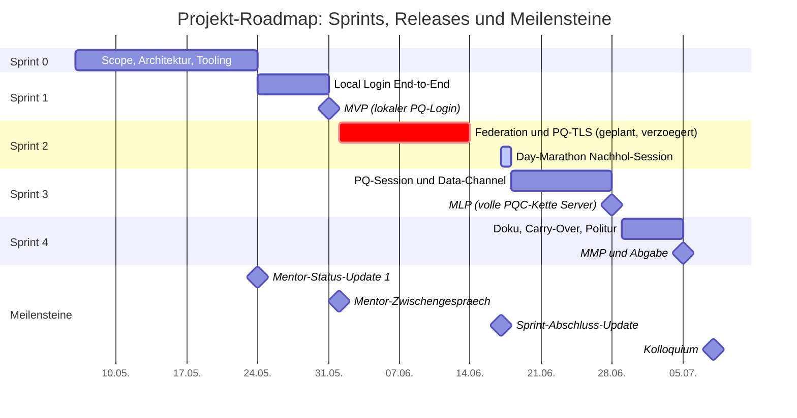

_Abbildung 1: Gantt-Chart mit Sprints, Releases und Meilensteinen_

### 3.3 Backlog-Struktur

Das Backlog ist in 14 Epics gegliedert und wuchs über das Projekt von 63 Stories (Sprint-0-Planung) auf final 71 Stories, weil Closing-Review-Findings als eigene Stories nachgezogen wurden (siehe 4.2). Zum Projektende sind 62 Stories mit 209 Story Points Done; offen bleiben die vier DOC-Stories (werden mit dieser Abgabe geschlossen), drei bewusst nicht gezogene Stretch-Stories (18 SP) und zwei Findings-Nachverfolgungs-Stories aus dem letzten Closing-Review. Die Epics bilden die Architektur-Bausteine ab, von der Infrastruktur über den Crypto-Abstraction-Layer, lokale Authentifizierung, Token-Service, Identity-Broker, hybrides TLS, PQ-Session und Datenkanal bis zur Mobile-App, Qualitätssicherung und Dokumentation. Die Reihenfolge folgt den Abhängigkeiten (Bottom-up: erst die Grundlagen, dann der Aufbau) und dem Risiko (riskante Stories früh, damit Lernen und Umplanung möglich bleiben). Das vollständige Backlog steht in [`docs/09_product_backlog.md`](docs/09_product_backlog.md), die Live-Version in Jira.

### 3.4 Priorisierung (MoSCoW)

Priorisiert wird mit MoSCoW. Die Verteilung:

| Priorität | Stories | Story Points (ca.) |
|---|---|---|
| Must | 59 | 212 |
| Should | 7 | 22 |
| Could (Stretch) | 3 | 18 |
| Total | 69 | 252 |

_Tabelle 4: MoSCoW-Verteilung des Backlogs (Planungsstand nach Sprint 2)_

Die hohe Must-Quote spiegelt die enge Verzahnung der Architektur-Komponenten: Fällt etwas weg, dann am ehesten App-Politur (z.B. Profile-Screen-Detail) oder Stretch-Goals. Ergänzend zu MoSCoW steuern drei weitere Achsen die Reihenfolge (Sprint-Zuordnung, Stretch-Markierung, Jira-Priority-Feld); Details in [`docs/09_product_backlog.md`](docs/09_product_backlog.md).

### 3.5 Kapazität und Schätzung

Die geplante Story-Point-Last liegt in allen Sprints bewusst über der klassischen Solo-Kapazität, weil die Schätzungen ohne AI-Unterstützung dokumentiert sind (siehe 2.4). Sprint 1 wurde gezielt als Mess-Experiment genutzt: geplant 41 Punkte auf 7 Tage, tatsächlich in rund 13,5 Stunden abgeschlossen. Diese empirischen Werte fliessen in die Sprint-Planung der Folge-Sprints und in die Reflexion (Abschnitt 6) ein.

### 3.6 SWOT-Analyse

Die SWOT-Analyse fasst die interne und externe Ausgangslage des Projekts zusammen. Die internen Faktoren speisen sich aus den Sprint-Retrospektiven, die externen aus dem Risk Register ([`docs/11_risk_register.md`](docs/11_risk_register.md)).

| | Hilfreich | Hinderlich |
|---|---|---|
| **Intern** | **Stärken:** AI-Workflow mit gemessenem Multiplier 6-14x; Crypto-Agility per Config; Prozessdisziplin (Evidence-Files, Closing-Reviews, Demos) | **Schwächen:** Solo-Kapazität fragil bei externer Belastung; kein echtes Peer-Review; Konventionen leiden unter Zeitdruck |
| **Extern** | **Chancen:** NIST-Standards final seit 2024; Broker-Pattern wiederverwendbar; frühe PQC-Praxiserfahrung | **Risiken:** Mobile-TLS ohne ML-KEM (R-T08); Reife der PQC-Libraries; Doku-Zeitfenster Sprint 4 (R-S04) |

_Tabelle 5: SWOT-Analyse (intern aus den Retrospektiven, extern aus dem Risk Register)_

---

## 4. Durchführung

Das Projekt lief über fünf Sprints (Sprint 0 bis 4). Pro Sprint zeigt dieser Abschnitt kompakt das Sprint-Ziel, den Verlauf (Burndown), die wichtigsten Ergebnisse und die Retrospektive als Mindmap. Die vollständigen Planning-, Review- und Retro-Protokolle liegen im [`sprint_journal/`](sprint_journal/), die Detail-Nachweise pro Story in den Evidence-Files und Jira-Done-Comments.

### 4.1 Sprint 0: Scope, Architektur und Tooling-Basis

**Zeitraum:** 06.05 bis 24.05.2026. **Sprint-Ziel:** "Scope, Architektur und Tooling-Basis ready". **Ergebnis:** teilweise erreicht.

Sprint 0 lieferte das konzeptionelle Fundament: die dokumentierte Architektur-Entscheidung zwischen drei Optionen (siehe Kapitel 9), vollständige Requirements mit acht Use Cases, das System-Design mit Komponenten- und Sequenz-Diagrammen, das Scrum-Setup mit Solo-Adaption, ein Product Backlog mit 63 Stories in 13 Epics, das Risk Register und ein Jira-Projekt mit 76 Issues. Nicht erreicht wurden die Infrastruktur-Stories (Docker-Compose-Skeleton, oqs-nginx-Image), die als Carry-Over in Sprint 1 wanderten. Der Sprint wurde dreimal transparent verlängert; die Retrospektive benennt das offen als Anti-Pattern (Sprint-Plan-Schleichung) und leitete daraus die Massnahmen Daily Journal, feste Wochen-Slots und Mentor-Updates ab.

| Gut gelaufen | Weniger gut | Massnahmen für Sprint 1 |
|---|---|---|
| Frühe Architektur-Entscheidung (08.05) | Untracked Work grösser als Tracked Work | Daily Journal konsequent führen |
| Templates und Doku-Struktur sofort produktiv | Inkonsistente Arbeit (0.5 h/Tag im Schnitt) | Feste Wochen-Slots reservieren |
| Verlängerungen transparent dokumentiert | Daily Journal nicht geführt | Mentor-Update nach jedem Sprint-Ende |

_Tabelle 6: Retrospektive Sprint 0 (Details in [`sprint_journal/sprint_0/04_retrospective.md`](sprint_journal/sprint_0/04_retrospective.md))_

### 4.2 Sprint 1: Local Login End-to-End

**Zeitraum:** 24.05 bis 31.05.2026. **Sprint-Ziel:** End-to-End-Login lokal durchspielbar (User via Admin-CLI angelegt, Login gegen `POST /auth/local/login`, ML-DSA-65-signierter Broker-Token verifizierbar). **Ergebnis:** vollständig erreicht, MVP-Release am 31.05.

Sprint 1 lieferte alle 41 geplanten Must-SP, alle 5 Stretch-SP und zusätzlich 10 SP Security-Middleware-Stories, die während des Sprints aus einem Closing-Review-Finding entstanden (PQC-19 deckte fünf fehlende Middlewares auf, die als Stories PQC-79 bis PQC-83 noch im Sprint umgesetzt wurden). Implementationszeit laut Worklogs: rund 14,3 Stunden.

| Epic | Stories | SP |
|---|---|---|
| Infrastruktur (INF, Carry-Over aus Sprint 0) | 2 | 10 |
| Skeletons Server und App (SKL) | 2 | 5 |
| Crypto-Foundation (CRY) | 3 | 13 |
| Token-Service (TOK) | 2 | 7 |
| Lokale Authentifizierung (AUT) | 4 | 13 |
| Security-Middlewares (SEC, aus Sprint 2 vorgezogen) | 5 | 10 |
| Qualität und Coverage (QUA) | 3 | 6 |
| App-Grundgerüst (APP, Stretch) | 3 | 5 |

_Tabelle 7: Sprint-1-Lieferumfang nach Epic (Detail-Review pro Story in [`sprint_journal/sprint_1/03_review.md`](sprint_journal/sprint_1/03_review.md))_

In diesem Sprint wurden drei Prozess-Konventionen etabliert, die das restliche Projekt getragen haben. Erstens die **Closing-Review-Prozedur**: Vor jeder Done-Transition läuft ein fixer Prüfablauf (Code nochmals kritisch lesen, Akzeptanzkriterien verifizieren, Test-Suite laufen lassen, Audit nach Sicherheits- und Qualitäts-Kategorien, Findings klassifizieren). Zweitens die **Evidence-Files** pro Story als Teil der DoD (siehe 2.3). Drittens die **Demo-Konvention**: Pro Meilenstein wird eine nummerierte Mini-Demo (D-001, D-002, ...) abgelegt, also eine dokumentierte Befehlsfolge mit erwarteten Outputs, sodass sich jeder Fortschritt jederzeit wiederholen lässt, statt nur "Tests sind grün" zu behaupten.

**Review und Demos:** Sprint-Ziel erreicht, der End-to-End-Login lief live im Container. Demos dieses Sprints: D-001 (Crypto-Foundation), D-002/D-003 (Token ausstellen und verifizieren), D-004 (Login-Pipeline End-to-End), D-005 (PQ-TLS-Handshake mit openssl), D-006 (Mobile-Login-Screen auf dem iPhone).

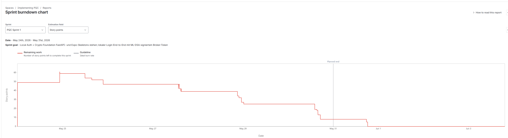

_Abbildung 2: Sprint-1-Burndown (Jira-Screenshot)_

| Gut gelaufen | Weniger gut | Massnahmen für Sprint 2 |
|---|---|---|
| AI-Multiplier 6.4x gemessen | SEC-Refinement erst während des Sprints | Planning-Checkliste vor Sprint-Start |
| Closing-Reviews und Evidence-Files etabliert | Setup-Friction in den Skeleton-Stories | OAuth-Setup früh in Sprint 2 priorisieren |
| Demo-Konvention D-NNN eingeführt | Eigenmächtige Done-Versuche der AI | AI-Multiplier-Hypothese weiter testen |

_Tabelle 8: Retrospektive Sprint 1 (Details in [`sprint_journal/sprint_1/04_retrospective.md`](sprint_journal/sprint_1/04_retrospective.md))_

### 4.3 Sprint 2: Federation und hybrides PQ-TLS

**Zeitraum:** geplant 01.06 bis 14.06.2026, faktisch abgeschlossen am 17.06. **Sprint-Ziel:** Federation-Login via Google/Microsoft mit ML-DSA-65-Broker-Token über hybride PQC-TLS-Verbindung. **Ergebnis:** vollständig erreicht für den Browser-zu-Backend-Pfad.

Sprint 2 ist der Ausnahme-Sprint des Projekts: Ein Problem bei meiner Arbeit machte den geplanten Zeitraum unbrauchbar. Statt das Sprint-Ziel zu reduzieren, habe ich den Sprint als Day-Marathon am 17.06 nachgeholt: alle 13 Stories (56 SP) in einer Block-Session von gut sechs Stunden.

| Epic | Stories | SP |
|---|---|---|
| OAuth-App-Setup Google/Microsoft (BRK-0) | 1 | 2 |
| Identity Broker / Federation (BRK) | 7 | 32 |
| Hybrides PQ-TLS (TLS) | 3 | 9 |
| Mobile-Federation (APP-7, APP-8) | 2 | 10 |

_Tabelle 9: Sprint-2-Lieferumfang nach Epic (Detail-Review in [`sprint_journal/sprint_2/03_review.md`](sprint_journal/sprint_2/03_review.md))_

Zwei wichtige Befunde aus diesem Sprint: Erstens die Entscheidung für Single-Tenant bei der Microsoft-App-Registrierung, die die App-Approval-Wartezeit und damit gleich zwei Risiken (R-T04, R-S05) elegant umging. Zweitens die Entdeckung der Mobile-TLS-Limitation (R-T08): mobile System-TLS-Stacks unterstützen X25519MLKEM768 noch nicht, weshalb der PQ-Schutz für die App auf der Application-Layer liegt (fachliche Einordnung in Kapitel 13).

**Review und Demo:** Sprint-Ziel für den Browser-zu-Backend-Pfad erreicht, verifiziert mit Demo D-007 (PQ-TLS-Handshake im Browser und via oqs-curl). Ehrlich festzuhalten: Der Federation-Login funktionierte End-to-End über den Browser gegen das Backend; in der Mobile-App selbst liess er sich nicht durchgängig abschliessen und blieb bis zum Projektende offen (siehe 12.1). Selbstkritisch dokumentiert ist auch die Kommunikation: Während der Verzögerung ging kein Status-Update an die Mentoren (siehe 4.6).

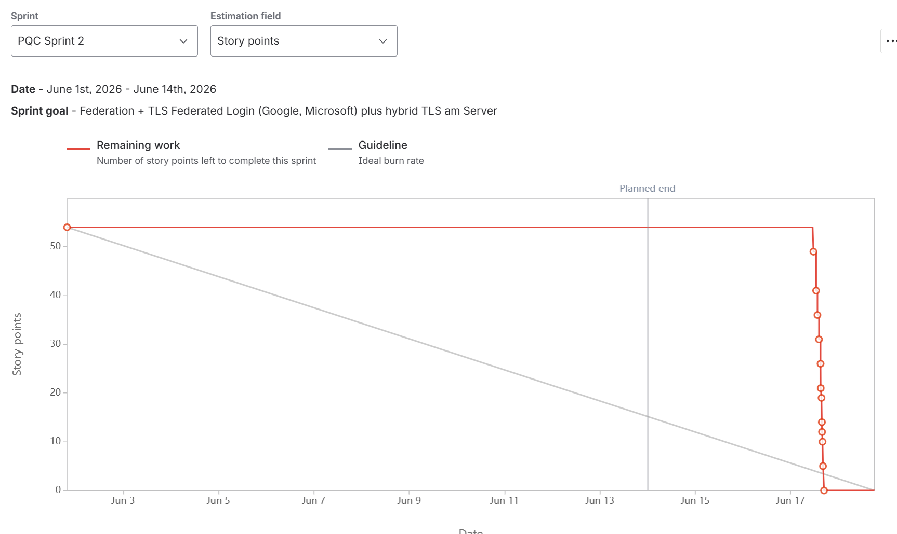

_Abbildung 3: Sprint-2-Burndown (Jira-Screenshot). Der Klippen-Verlauf entspricht der Block-Session am 17.06 und wird in Abschnitt 6 reflektiert._

| Gut gelaufen | Weniger gut | Massnahmen für Sprint 3 |
|---|---|---|
| Planning-Checkliste hat sich konkret ausgezahlt | Kein Mentor-Update während der Verzögerung | Update-Regel: innert 24-48 h informieren |
| Single-Tenant-Entscheidung als Risk-Workaround | Konventionen unter Zeitdruck ausgesetzt | Plattform-Capability-Check ergänzen |
| Code-Reuse-Pairs (BRK-5/6, APP-7/8) | R-T08 erst in der Implementation entdeckt | Harter Halbzeit-Check im komprimierten Sprint 3 |

_Tabelle 10: Retrospektive Sprint 2 (Details in [`sprint_journal/sprint_2/04_retrospective.md`](sprint_journal/sprint_2/04_retrospective.md))_

### 4.4 Sprint 3: PQ-Session und verschlüsselter Datenkanal

**Zeitraum:** 18.06 bis 28.06.2026 (auf 11 Tage komprimiert wegen der Sprint-2-Verzögerung, R-S06). **Sprint-Ziel:** Mobile-Pfad End-to-End auf dem iPhone mit PQ-Session (ML-KEM-768 plus HKDF) und AES-256-GCM-verschlüsseltem `/api/profile`-Call. **Ergebnis:** teilweise erreicht.

Der Server-Pfad wurde komplett geliefert (52 von 79 SP). Die vier Mobile-Stories plus zwei Test-Stories (27 SP) blieben liegen und gingen als Carry-Over nach Sprint 4. Ursache war eine Ferien-Phase, in der ich das Projekt bewusst weniger priorisiert habe; die Retrospektive arbeitet das offen auf (siehe auch 6.3).

| Epic | Stories | SP |
|---|---|---|
| Crypto-Foundation KEM/HKDF/AEAD (CRY) | 4 | 17 |
| PQ-Session-Layer mit Redis (SES) | 4 | 18 |
| Verschlüsselter Datenkanal (DCH) | 4 | 17 |
| Mobile-App und Tests (APP, QUA) | 0 von 6 | 0 von 27 |

_Tabelle 11: Sprint-3-Lieferumfang nach Epic (Detail-Review in [`sprint_journal/sprint_3/03_review.md`](sprint_journal/sprint_3/03_review.md))_

Prozessseitig bewährte sich das Hook-First-Pattern in der Story-Sequenzierung (Foundation-Stories legen Hooks, Konsumenten-Stories laufen dadurch in Minuten durch) und die Wire-Format-Spezifikation als lebendes Architektur-Artefakt, das mit jeder Story mitwuchs.

**Review und Demo:** Sprint-Ziel teilweise erreicht. Der komplette Server-Roundtrip (Login, PQ-Session, verschlüsselter Profil-Abruf, Replay-Test) ist als Demo D-008 in acht Schritten reproduzierbar dokumentiert.

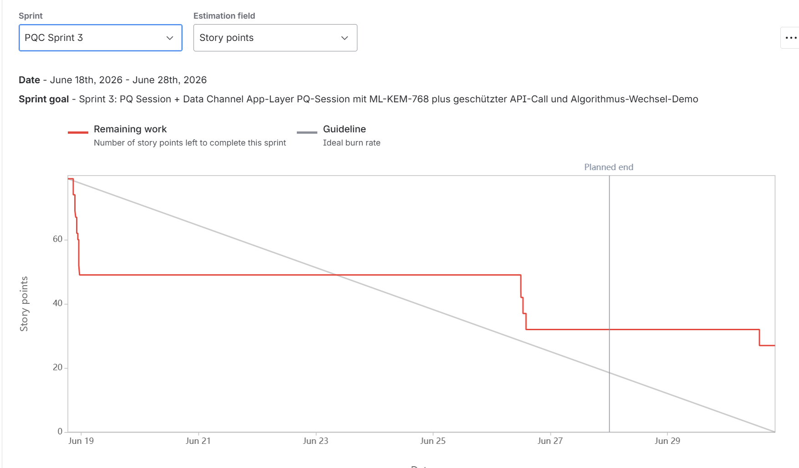

_Abbildung 4: Sprint-3-Burndown (Jira-Screenshot). 27 SP gingen als Carry-Over nach Sprint 4._

| Gut gelaufen | Weniger gut | Massnahmen für Sprint 4 |
|---|---|---|
| Hook-First-Pattern in der Story-Reihenfolge | Ferien verschluckten die Mobile-Stories | Carry-Over-Rush an Tag 1, Doku als Fallback |
| Wire-Format-Spec als lebendes Artefakt | Halbzeit-Check nicht abgehalten | Update-Regel strikt einhalten |
| Pattern-Replikation aus früheren Sprints | Mentor-Update erneut zu spät | Halbzeit-Check 01.07 als harter Korrektur-Punkt |

_Tabelle 12: Retrospektive Sprint 3 (Details in [`sprint_journal/sprint_3/04_retrospective.md`](sprint_journal/sprint_3/04_retrospective.md))_

### 4.5 Sprint 4: Abgabe-Sprint

**Zeitraum:** 29.06 bis 05.07.2026, Kolloquium am 08.07. **Sprint-Ziel:** Abgabe komplett (Schlussbericht, Präsentation, README, ADRs) plus Carry-Over-Rush am ersten Sprint-Tag. **Ergebnis:** Carry-Over-Rush erfolgreich, Doku mit dieser Abgabe abgeschlossen.

Die Strategie aus dem Planning (Day-Marathon für die Carry-Over-Stories an Tag 1, bei Misserfolg radikaler Schwenk auf Doku-Only) ging auf:

| Story-Gruppe | Stories | SP |
|---|---|---|
| Mobile-App Carry-Over (SessionContext, secureClient, Home-, Profile-Screen) | 4 | 14 |
| Integrations- und End-to-End-Tests (QUA-4, QUA-5) | 2 | 13 |
| Performance-Benchmarks (QUA-6/7/8) | 3 | 6 |
| Schlüssel-Rotation und JWKS-Endpoint (TOK-3/4) | 2 | 7 |
| Dokumentation (DOC-1 bis DOC-4) | 4 | 26 |

_Tabelle 13: Sprint-4-Lieferumfang (DOC-Stories werden mit dieser Abgabe geschlossen)_

Der finale Container-Testlauf zeigte 420 grüne Tests, und alle drei Performance-Ziele wurden mit deutlicher Marge erfüllt (Details in Kapitel 11 und 12). **Review und Demo:** Der lokale Mobile-Pfad ist End-to-End demonstrierbar; die Live-Demo lief am Kolloquium erfolgreich (Demo D-009: Login, PQ-Session, entschlüsseltes Profil auf dem iPhone). Zwei Punkte hält das Review ehrlich fest: QUA-4/5 wurden erst am 07.07 und damit nach dem offiziellen Sprint-Ende abgeschlossen, und die Mobile-Federation-Lücke aus Sprint 2 wurde dokumentiert statt behoben (siehe 12.1).

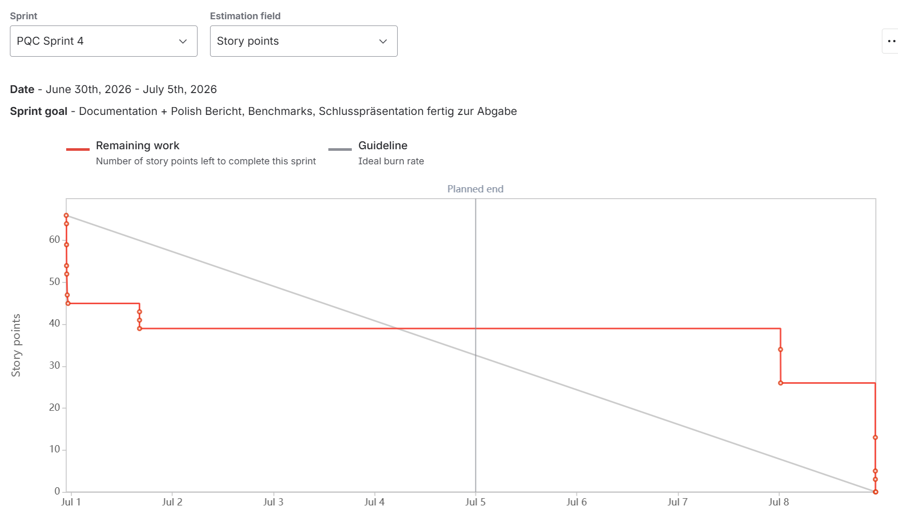

_Abbildung 5: Sprint-4-Burndown (Jira-Screenshot)_

> **TODO (Dodoe):** `BurndownChart_Sprint4.png` nach dem Sprint-Abschluss in Jira exportieren und unter `sprint_journal/sprint_4/evidence/images/` ablegen (Ordner existiert schon), dann rendert das Bild oben automatisch.

| Gut gelaufen | Weniger gut | Erkenntnisse für künftige Projekte |
|---|---|---|
| Day-Marathon-Strategie mit Doku-Fallback ging auf | QUA-4/5 erst nach offiziellem Sprint-Ende fertig | Doku-Struktur beim Planning fixieren, nicht am Abgabetag |
| Halbzeit-Check und Update-Regel diesmal eingehalten | Doku-Struktur-Entscheide erst am Abgabetag | Screenshots und Nachweise laufend sammeln |
| Evidence und Demos beschleunigten das Berichtschreiben | Mobile-Federation-Lücke nur dokumentiert, nicht behoben | Velocity-Zählregeln ab Tag 1 definieren |

_Tabelle 14: Retrospektive Sprint 4 (Details in [`sprint_journal/sprint_4/04_retrospective.md`](sprint_journal/sprint_4/04_retrospective.md))_

### 4.6 Stakeholder-Kommunikation

Die Kommunikation mit den beiden Experten lief über MS Teams und dokumentierte Status-Updates: ein schriftliches Status-Update vor dem ersten Mentor-Termin (24.05, siehe [`sprint_journal/mentor_meetings/`](sprint_journal/mentor_meetings/)), das Zwischengespräch am 01.06, das Sprint-2-Abschluss-Update am 17./18.06 und ein Update nach Sprint-3-Abschluss (30.06). Das GitHub-Repo ist für die Experten einsehbar, sodass der Projektstand jederzeit überprüfbar war (Sprint-Journal, Evidence-Files, Jira-Links). Die Lernkurve bei der Kommunikation ist in den Retrospektiven ehrlich dokumentiert: Nach dem Versäumnis während der Sprint-2-Verzögerung habe ich mir eine feste Regel gesetzt: Bei jedem unerwarteten Problem, das den Plan stört, geht innerhalb von ein bis zwei Tagen ein kurzes Status-Update an die Mentoren, nicht erst, wenn das Problem gelöst ist. In Sprint 3 habe ich diese Regel gleich wieder verletzt (das Update kam erst zwei Tage nach Sprint-Ende), in Sprint 4 dann eingehalten.

---

## 5. Risikomanagement

Die Risiken wurden von Sprint 0 an in einem Risk Register ([`docs/11_risk_register.md`](docs/11_risk_register.md)) geführt: pro Risiko eine Formulierung nach dem Muster "Aufgrund... könnte... anhand...", eine Bewertung nach Eintrittswahrscheinlichkeit und Schadensausmass, konkrete Massnahmen und ein Status-Lifecycle (Active, Monitor, Mitigated, Eingetreten). Das Register wurde in jedem Sprint-Review inspiziert und angepasst. Es war damit ein echtes Arbeitsinstrument und nicht nur eine Grafik für den Bericht.

| ID | Risiko (Kurzform) | Eintritt | Schaden | Score | Status (Ende Sprint 4) |
|---|---|---|---|---|---|
| R-S04 | Doku-Zeit in Sprint 4 zu kurz | Hoch | Hoch | 9 | Active (kritisch nach Sprint 3) |
| R-S01 | Sprint-Kapazität wird systematisch überschritten | Hoch | Mittel | 6 | Active |
| R-T04 | OIDC-Provider-Setup-Komplexität (Google, Microsoft) | Mittel | Hoch | 6 | Mitigated (Single-Tenant) |
| R-T01 | liboqs-python Build oder Install schlägt fehl | Mittel | Hoch | 6 | Mitigated (25.05) |
| R-S06 | Sprint-3-Komprimierung wegen Sprint-2-Verzögerung | Mittel | Hoch | 6 | Active |
| R-T03 | Mobile-OS-spezifische Crypto-Quirks (iOS/Android) | Mittel | Mittel | 4 | Active |
| R-S05 | Externe Abhängigkeiten (OAuth-Setup) verzögern Sprint 2 | Mittel | Mittel | 4 | Mitigated (Single-Tenant) |
| R-T07 | Expo Deep-Link für OAuth-Callback nicht zuverlässig | Mittel | Mittel | 4 | Mitigated (17.06) |
| R-T02 | @noble/post-quantum API-Instabilität | Niedrig | Mittel | 2 | Monitor |
| R-T05 | nginx plus oqs-provider TLS-Setup bricht | Niedrig | Mittel | 2 | Monitor |
| R-T06 | Redis-Session-Store Bugs (Async, TTL, Nonce) | Niedrig | Mittel | 2 | Mitigated (28.06) |
| R-S03 | Mentor-Termin-Scheduling | Mittel | Niedrig | 2 | Monitor |
| R-S02 | Sprint-0-Verzug | Eingetreten | Mittel | --- | Mitigated |
| R-T08 | Mobile-Client kann PQC-TLS nicht End-to-End nutzen | Eingetreten | Mittel | --- | Identifiziert (17.06) |

_Tabelle 15: Risiko-Übersicht mit Bewertung und Status; die vollständigen Beschreibungen und Massnahmen pro Risiko stehen im Risk Register._

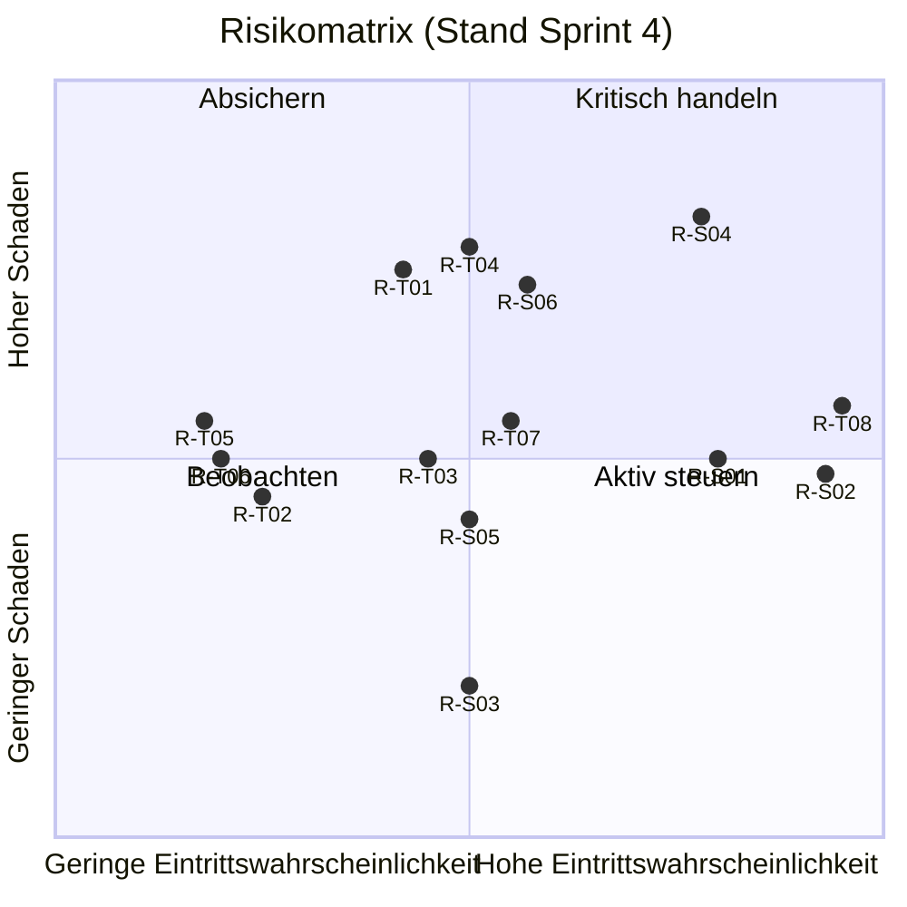

_Abbildung 6: Risikomatrix nach Eintrittswahrscheinlichkeit und Schadensausmass. R-S02 und R-T08 sind eingetretene Risiken (Eintrittswahrscheinlichkeit am rechten Rand). Vollständige Bewertung, Status und Massnahmen pro Risiko in [`docs/11_risk_register.md`](docs/11_risk_register.md)._

### 5.1 Top-Risiken und ihre Massnahmen

Die drei am höchsten bewerteten Risiken mit ihren zentralen Massnahmen:

| Risiko | Score | Massnahme | Wirkung |
|---|---|---|---|
| R-S04: Doku-Zeit in Sprint 4 zu kurz | 9 | Doku-Stories unverhandelbar priorisiert, Carry-Over-Rush auf Tag 1 begrenzt mit hartem Fallback auf Doku-Only | Strategie ging auf: Carry-Over an Tag 1 abgeschlossen, Rest des Sprints für die Doku |
| R-T04: OIDC-Provider-Setup-Komplexität | 6 | OAuth-Setup als eigene Story (BRK-0) an den Sprint-Anfang gezogen; Single-Tenant statt Common-Tenant bei Microsoft | App-Approval-Wartezeit komplett vermieden, R-T04 und R-S05 mitigated |
| R-S01: Sprint-Kapazität systematisch überschritten | 6 | Schätzungen bewusst als klassische Solo-Schätzung dokumentiert, reale Kapazität als Richtgrösse, Defer-Kandidaten pro Sprint markiert | Kein Sprint scheiterte an Überplanung; Scope-Cuts waren vorbereitet statt ad hoc |

_Tabelle 16: Top-Risiken mit Massnahmen und Wirkung_

### 5.2 Eingetretene Risiken

Zwei Risiken sind real eingetreten und ehrlich als solche dokumentiert. **R-S02 (Sprint-0-Verzug):** dreimal verlängerter Sprint 0; kompensiert durch die hohe Sprint-1-Velocity und als Prozess-Lesson in die Retro aufgenommen. **R-T08 (Mobile-Client kann PQC-TLS nicht End-to-End nutzen):** während Sprint 2 entdeckt; mobile System-TLS-Stacks (iOS Network Framework, Android Conscrypt) unterstützen X25519MLKEM768 noch nicht. Dass dieses Risiko das Projekt nicht gefährdet hat, liegt an einem Design-Entscheid aus Sprint 0: Die PQ-Verschlüsselung der App liegt bewusst auf der Application-Layer und ist damit vom TLS-Stack des Betriebssystems unabhängig (siehe Kapitel 9). Als Konsequenz wurde ausserdem die Sprint-Planning-Checkliste erweitert. Diese Checkliste (eingeführt nach Sprint 1) ist eine Liste von Querschnittsthemen, die ich vor jedem Sprint-Start gegen die geplanten Stories prüfe: Welche Security-Aspekte, Logging-Themen und Plattform-Grenzen betreffen diesen Sprint? Neu gehört dazu ein expliziter Plattform-Capability-Check (was können Browser, Mobile-OS und Server jeweils wirklich?), damit Limitationen wie R-T08 künftig im Planning statt erst in der Implementation auffallen.

Nachtrag zum Projektende: Mit iOS 26 hat Apple X25519MLKEM768 im System-TLS (URLSession/Network) standardmässig aktiviert. Die Limitation R-T08 löst sich damit für aktuelle Geräte auf, was die Architektur-Entscheidung bestätigt: Der Server bietet den hybriden Schlüsselaustausch bereits an, neue OS-Versionen handeln ihn automatisch aus, und die App-Layer-PQ-Session bleibt als Ende-zu-Ende-Schutz für ältere Geräte und als Defense-in-Depth bestehen.

---

## 6. Reflexion und Lessons Learned

### 6.1 AI-Multiplier: das Mess-Experiment

Die in 2.4 beschriebene Besonderheit, klassische Schätzung ohne AI gegen reale Arbeitszeit mit AI zu messen, hat über vier Sprints folgende Datenbasis ergeben:

| Sprint | Geplant (SP) | Geliefert (SP) | Klassische Schätzung (h, ohne AI) | Reale Zeit (h, mit AI) | Aggregierter AI-Multiplier |
|---|---|---|---|---|---|
| 1 | 46 (+10 im Sprint aufgenommen) | 47 | ca. 92 h | ca. 14,3 h | 6.4x |
| 2 | 56 | 56 | ca. 83 h | ca. 6,1 h (Block-Session) | 13.6x |
| 3 | 79 | 52 | ca. 76 h | ca. 7,3 h | 10.4x |
| 4 | 66 | 40 plus 26 DOC | teilweise erfasst | teilweise erfasst | Einzelwerte (QUA-4 2.8x, QUA-5 10x) |

_Tabelle 17: Velocity und AI-Multiplier pro Sprint (Quellen: Sprint-Reviews Abschnitt 6, Daily-Journal-Zeittabellen, Jira-Worklogs)_

Zur Lesart: Die klassische Schätzung ist die Summe der T-Shirt-Stunden-Anker (XS=1h, S=3h, M=7h, L=15h) über die abgeschlossenen Stories des Sprints, also der Aufwand, den ich als Solo-Entwickler ohne AI-Unterstützung veranschlagt hätte (siehe 2.4). Die reale Zeit stammt aus den Jira-Worklogs. Der Multiplier ist das Verhältnis der beiden.

Die wichtigste Erkenntnis ist nicht der Mittelwert, sondern die Heterogenität. Der Multiplier ist weniger eine Eigenschaft des Werkzeugs als der Arbeitsweise: Block-Sessions mit Code-Reuse-Pairs treiben ihn nach oben (Sprint 2: 13.6x, Einzelwerte bis 22x bei Hook-First-Stories), Setup-Friction und neue Plattform-Themen drücken ihn (Skeleton-Stories: 2x), der stabile Mittelbereich für echte Code-Stories mit Tests liegt bei 5x bis 8x. Auffällig ist ausserdem ein Investitions-Effekt: Die ersten Sprints bauen Patterns auf (Crypto-Wrapper, Router-Struktur, Test-Setup), von denen die späteren Sprints profitieren. Sprint 3 hatte deshalb keine Ausreisser nach unten mehr. Meine konservative Planungs-Annahme von 1.5x war bewusst tief angesetzt und wurde klar übertroffen; als Planungs-Anker für künftige Arbeiten mit AI-Unterstützung würde ich 4x bis 6x für Code-Arbeit und 2x für Setup- und Plattform-Arbeit ansetzen.

Zur Transparenz gehört auch eine Inkonsistenz in der eigenen Datenbasis: Das Sprint-1-Review zählt 47 gelieferte SP (ohne Sprint-0-Carry-Over), die Daily-Journal-Zeittabelle summiert inklusive Carry-Over und vorgezogener SEC-Stories 69 SP. Der Burndown in 4.2 nutzt die Journal-Basis und legt das in der Beschriftung offen. Die Lesson: Zählregeln (was zählt zur Sprint-Velocity) gehören von Anfang an fixiert, nicht erst bei der Auswertung.

### 6.2 Solo-Scrum: was trug und was fehlte

Die Solo-Adaption hat sich als tragfähig erwiesen, aber nicht von allein: Getragen haben die Trennung der Rollen in zwei getrennte AI-Arbeitsstränge (Co-Scrum-Master für Prozess, Senior-Engineer für Code), die Evidence-Files als Ersatz für nachvollziehbare Team-Kommunikation und die Closing-Reviews als Ersatz für das fehlende Vier-Augen-Prinzip. Gefehlt haben echtes Peer-Feedback (AI-Reviews prüfen Code, aber hinterfragen keine Ziele) und eine belastbare Velocity, weil ein Einzelner mit schwankender Wochen-Kapazität keine stabile Datenbasis erzeugt. Der unangenehmste, aber ehrlichste Befund: Meine Konventionen haben nur unter normalen Bedingungen gehalten. In beiden Ausnahme-Situationen (Arbeit-Problem in Sprint 2, Ferien in Sprint 3) wurden Daily Journal, Demos und Evidence-Files teilweise ausgesetzt. Die Konsequenz für künftige Projekte: Beim Sprint-Start bewusst entscheiden und dokumentieren, welche Konventionen bei Druck pausieren dürfen, statt sie stillschweigend fallen zu lassen.

### 6.3 Selbstmanagement

Über das Projekt haben sich zwei Arbeitsmodi herauskristallisiert: verteilte Arbeitstage (Standard-Schedule: Wochenenden plus Mittwoch) und Block-Sessions (Day-Marathons). Block-Sessions sind pro Stunde am produktivsten, aber emotional anstrengend und als Regelmodus nicht tragfähig; sie taugen als Notfall-Werkzeug, nicht als Plan. Die wichtigste persönliche Lektion kommt aus Sprint 3: Der Sprint fiel in meine Ferien, und der Versuch, nebenbei am Projekt zu arbeiten, hat nachweisbar wenig gebracht, die Mobile-Stories blieben komplett liegen (27 SP Carry-Over). Gemischte Ferien-Projekt-Phasen funktionieren bei mir nicht; es braucht entweder klare Projekt-Termine oder klare Ferien-Termine. Positiv: Die zusätzlichen Sessions in Sprint 1 kamen aus Motivation, nicht aus Pflicht. Sichtbarer Fortschritt war für mich der stärkste Antrieb, und die Demo-Konvention hat genau diesen Fortschritt systematisch sichtbar gemacht.

### 6.4 Handlungsempfehlungen

Für künftige Semesterarbeiten und vergleichbare Solo-Projekte mit AI-Unterstützung: Erstens Zählregeln und Zeiterfassung ab Tag 1 fixieren (siehe 6.1). Zweitens Cross-Cutting-Concerns und Plattform-Capabilities als feste Planning-Checkliste führen, das hätte hier zwei Sprint-Überraschungen (SEC-Stories, R-T08) verhindert. Drittens Evidence-Files und Closing-Reviews auch unter Zeitdruck nicht aussetzen: Sie waren die Grundlage dafür, dass ich diesen Bericht in Sprint 4 schnell und belastbar schreiben konnte. Viertens den AI-Multiplier weiter pro Story tracken, aber mit differenzierten Kategorien (Code, Setup, Verifikation), damit die Planung auf Story-Typ-Ebene kalibriert werden kann.

---

---

## 7. Fachlicher Kontext und Theorie

### 7.1 Bedrohungsmodell

Für TLS und Authentifizierung sind zwei Quanten-Bedrohungen relevant, die unterschiedliche Algorithmen-Klassen betreffen und unterschiedlich dringend sind:

| Bedrohung | Betrifft | Dringlichkeit | Quantensichere Antwort |
|---|---|---|---|
| Vertraulichkeits-Bruch aufgezeichneter Sessions ("Harvest Now, Decrypt Later") | Schlüsselaustausch (ECDHE, RSA-KEX) | **Heute schon ausnutzbar**: aufzeichnen kann jeder jetzt | ML-KEM (FIPS 203) |
| Identitäts-Fälschung, sobald ein kryptografisch relevanter Quantencomputer existiert | Signaturen (ECDSA, RSA, EdDSA) auf Zertifikaten und Tokens | Erst mit realem Quantencomputer | ML-DSA (FIPS 204), SLH-DSA (FIPS 205) |

_Tabelle 18: Zwei Quanten-Bedrohungen mit unterschiedlicher Dringlichkeit (Quelle: [`docs/02_pqc_technical_brief.md`](docs/02_pqc_technical_brief.md))_

Weil die beiden Bedrohungen unterschiedlich dringend sind, rollt die Industrie den hybriden PQ-Schlüsselaustausch Jahre vor den PQ-Zertifikaten aus. Das prägt auch die Prioritäten in dieser Arbeit: Schlüsselaustausch zuerst, Signaturen dort, wo ich sie selbst kontrolliere (die eigenen Tokens).

Die mathematische Grundlage der Bedrohung ist Shors Algorithmus, der Faktorisierung und diskrete Logarithmen auf einem Quantencomputer effizient löst und damit RSA, ECC und ECDH bricht. Die NIST-Standards basieren stattdessen auf Gitter-Problemen (Module Learning with Errors), für die kein effizienter Quantenalgorithmus bekannt ist. Symmetrische Verfahren wie AES-256 gelten mit ausreichender Schlüssellänge als quantensicher genug (Grovers Algorithmus halbiert effektiv die Schlüssellänge, mehr nicht).

### 7.2 Die NIST-Standards: ML-KEM und ML-DSA

**ML-KEM (FIPS 203)** ist ein Key Encapsulation Mechanism, der Nachfolger von ECDH für den Schlüsselaustausch. Ein KEM funktioniert in drei Schritten: KeyGen erzeugt ein Schlüsselpaar, Encaps erzeugt gegen den öffentlichen Schlüssel ein gemeinsames Geheimnis samt Ciphertext, Decaps rekonstruiert das Geheimnis aus dem Ciphertext. Das gemeinsame Geheimnis wird nie übertragen:

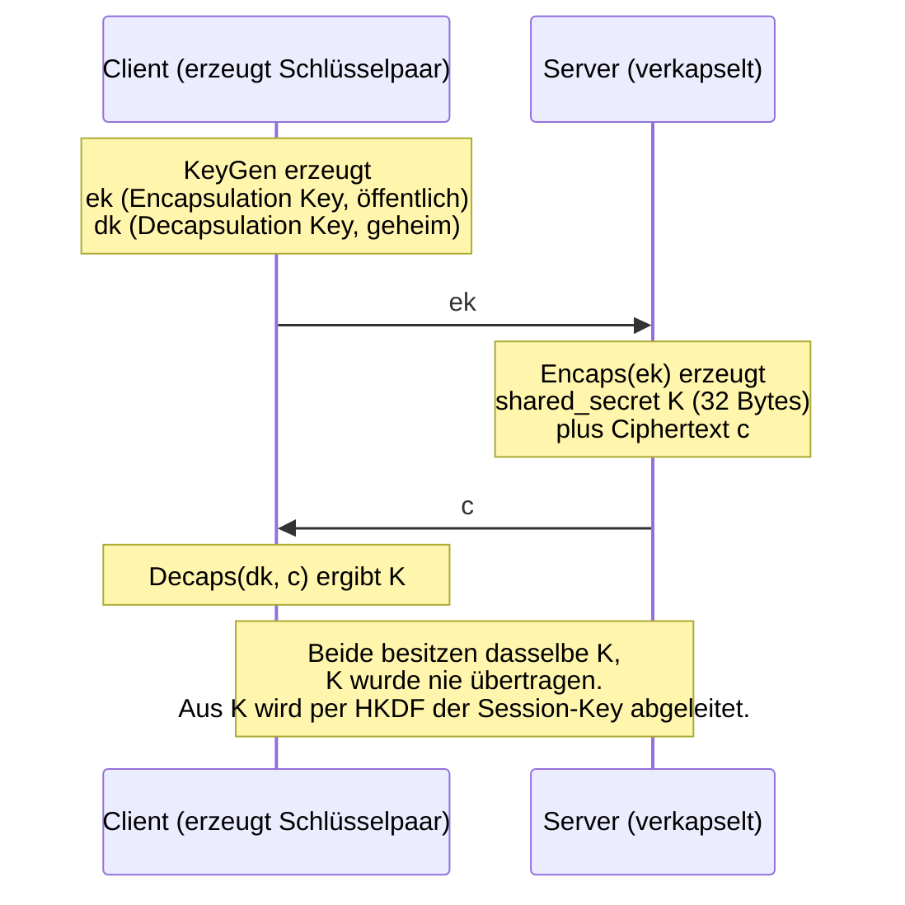

_Abbildung 7: Das KEM-Prinzip (FIPS 203), hier in der Rollenverteilung dieser Arbeit: die App erzeugt das Schlüsselpaar, der Server verkapselt (vergleiche Abbildung 12)._

**ML-DSA (FIPS 204)** ist das Signatur-Verfahren, der Nachfolger von ECDSA und RSA für digitale Unterschriften. Der Server signiert seine Broker-Tokens mit dem geheimen Schlüssel, jeder Besitzer des öffentlichen Schlüssels kann die Signatur prüfen, aber niemand kann sie fälschen:

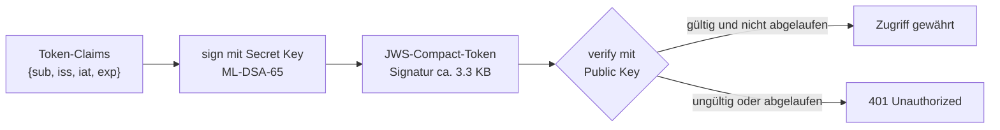

_Abbildung 8: Signieren und Verifizieren des Broker-Tokens mit ML-DSA-65 (FIPS 204)_

Der praktisch wichtigste Unterschied zu den klassischen Verfahren sind die Grössen der Schlüssel und Signaturen. Sie beeinflussen Token-Grössen, Header-Limits und die Bytes im Handshake und müssen darum beim Design von Anfang an mitgedacht werden:

| Verfahren | Public Key | Signatur / Ciphertext | Klassisches Pendant |
|---|---|---|---|
| ML-KEM-768 | 1184 B | Ciphertext 1088 B | ECDH X25519: 32 B / 32 B |
| ML-DSA-65 | 1952 B | Signatur ca. 3.3 KB | ECDSA P-256: 64 B / 64-72 B |
| SLH-DSA (Backup) | 32-64 B | Signatur 7-50 KB | --- |

_Tabelle 19: Grössenvergleich der PQC-Verfahren gegen klassische Kryptografie (Quellen: FIPS 203/204/205)_

Aus dieser Tabelle habe ich zwei konkrete Design-Entscheidungen abgeleitet: SLH-DSA scheidet für mobile, Latenz-sensitive Tokens aus (zu grosse Signaturen), und der ML-DSA-Token wird bei Bedarf im Body statt im Authorization-Header transportiert, weil rund 4 KB Header bei manchen Zwischenstationen Probleme machen. Als Parameter-Sets habe ich ML-KEM-768 und ML-DSA-65 gewählt, die von NIST empfohlenen mittleren Sicherheitsstufen.

> Hinweis zur Namensgebung: Ältere Bibliotheken und Texte sagen "Kyber" und "Dilithium". Das sind die Vor-Standardisierungs-Namen; ML-KEM und ML-DSA sind die standardisierten Versionen mit kleinen, aber inkompatiblen Anpassungen. Für diese Arbeit habe ich ausschliesslich Bibliotheken verwendet, die die standardisierte Version implementieren.

### 7.3 Hybrider Schlüsselaustausch in TLS 1.3

Weil ML-KEM jung ist, kombiniert die Praxis es mit dem bewährten X25519 zu einem hybriden Schlüsselaustausch: Das TLS-Shared-Secret wird aus beiden Anteilen abgeleitet, die Verbindung bleibt also sicher, solange mindestens eines der beiden Verfahren hält. Der IETF-Draft `draft-ietf-tls-ecdhe-mlkem` definiert dafür die Gruppe **X25519MLKEM768** (NamedGroup `0x11ec`), die dieser Server anbietet:

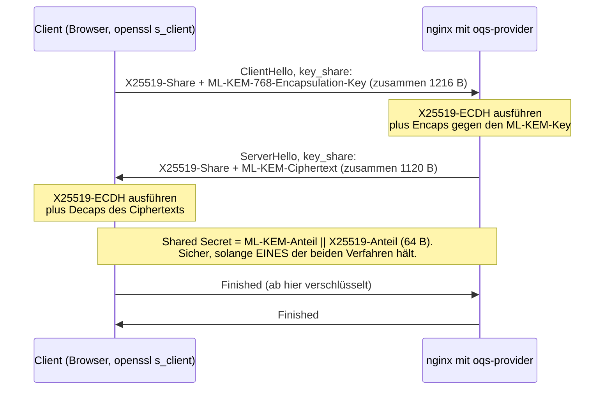

_Abbildung 9: Hybrider TLS-1.3-Handshake mit X25519MLKEM768 (nach draft-ietf-tls-ecdhe-mlkem)_

### 7.4 Stand der Adoption 2026

Der hybride Schlüsselaustausch ist Mainstream: Chrome (ab 131), Firefox (ab 132), Edge, OpenSSL 3.5, Go 1.24 sowie grosse Cloud-Anbieter (AWS, Cloudflare) sprechen X25519MLKEM768 als Default; über die Hälfte des Browser-TLS-Verkehrs sendet 2026 PQ-Key-Shares. Ganz anders die Signatur-Seite: ML-DSA in TLS ist noch ein Draft, keine öffentliche CA stellt ML-DSA-Zertifikate in der Breite aus, und die grossen Identity Provider signieren ihre OIDC-Tokens weiterhin klassisch (RS256). Auf Mobile kommt eine dritte Lücke dazu: Die System-TLS-Stacks von iOS und Android unterstützten ML-KEM während der Projektlaufzeit nicht, und Apps können die Cipher-Aushandlung nicht beeinflussen. Erst mit iOS 26, das gegen Ende dieses Projekts erschien, beginnt sich das zu ändern (siehe Abschnitt 5.2).

An diesen drei Lücken orientiert sich die Architektur dieser Arbeit: PQ-TLS dort, wo es heute geht (Server-Seite), eigene ML-DSA-Signaturen dort, wo ich sie kontrolliere (Broker-Token), und eine PQ-Session auf Applikationsebene dort, wo die Plattform kein PQ-TLS erlaubt (Mobile).

---

## 8. Anforderungen

Das Requirements Engineering ([`docs/05_requirements.md`](docs/05_requirements.md), rund 1900 Zeilen) leitet aus acht Use Cases die funktionalen Anforderungen ab, ergänzt um nicht-funktionale Anforderungen und Constraints. Die Nachverfolgbarkeit von Use Case über Requirement bis zur Story und ihrem Test ist in der Traceability-Matrix ([`docs/12_traceability_matrix.md`](docs/12_traceability_matrix.md)) dokumentiert.

| Use Case | Titel | Priorität |
|---|---|---|
| UC-1 | Lokaler Login mit Email/Passwort | Must |
| UC-2 | Login mit Google (Federated) | Must |
| UC-3 | Login mit Microsoft (Federated) | Should |
| UC-4 | Etablierung der PQ-Session nach Login | Must |
| UC-5 | Geschützter API-Call über die PQ-Session | Must |
| UC-6 | Token-Ablauf und Re-Authentication | Should |
| UC-7 | Algorithmus-Wechsel via Config (Crypto-Agility) | Must |
| UC-8 | Neuer externer IdP wird hinzugefügt (Erweiterbarkeit) | Could (Stretch) |

_Tabelle 20: Use-Case-Übersicht mit MoSCoW-Priorität_

Die 20 funktionalen Requirements gruppieren sich entlang der Architektur-Bausteine: lokale Authentifizierung (FR-Auth), Identity-Broker-Federation (FR-Broker), Token-Ausstellung und -Verifikation (FR-Token), PQ-Session (FR-Session), verschlüsselter Datenkanal (FR-DataChannel) und Crypto-Agility (FR-Crypto). Bei den nicht-funktionalen Anforderungen sind drei messbare Performance-Ziele hervorzuheben, deren Nachweis in Abschnitt 12.2 steht: PQ-Session-Etablierung unter 500 ms (NFR-Perf-1), ML-DSA-Token-Verifikation unter 10 ms (NFR-Perf-2), Verschlüsselungs-Overhead pro API-Call unter 50 ms (NFR-Perf-3). Die Security-NFRs verlangen unter anderem Replay-Schutz, Schutz vor User-Enumeration und CSRF-Schutz im OIDC-Flow.

Zwei Constraints haben die Architektur entscheidend geprägt: **C-Tech-1** (mobile Apps haben keinen Zugriff auf die TLS-Cipher-Aushandlung) erzwingt die PQ-Session auf Applikationsebene, und **C-Tech-4** (externe IdP-Tokens sind 2026 klassisch signiert) erzwingt das PQ-Uplift-Pattern aus Kapitel 9.

---

## 9. Architektur und Design

### 9.1 Evaluation der Lösungsansätze

Vor der Implementierung wurden drei Architektur-Optionen evaluiert und dokumentiert ([`docs/03_entscheidung_auth_architektur.md`](docs/03_entscheidung_auth_architektur.md)):

| Kriterium | Option 1: Voller OIDC-Provider | Option 2: Reines Custom Auth | Option 3: Custom Auth + Identity Broker |
|---|---|---|---|
| Standards-Compliance | Hoch (Provider-Rolle) | Keine | Mittel (OIDC-Client-Rolle) |
| Geschätzter Aufwand | 100-140 h | 50-70 h | 70-100 h |
| Anteil PQC am Code | ca. 25% | ca. 60% | ca. 50% |
| Realitäts-Anker | Niemand hostet 2026 einen neuen IdP | Reines Schul-Beispiel | Entspricht industrieller Praxis (Cognito, Keycloak, Zitadel) |
| Externe Logins | Nein | Nein | Ja (Google, Microsoft) |

_Tabelle 21: Vergleich der drei evaluierten Architektur-Optionen (gekürzt, vollständig in docs/03)_

Ich habe mich für **Option 3** entschieden. Sie funktioniert als Demo (der lokale Login zeigt alle PQC-Aspekte sauber) und gleichzeitig als realistische Architektur (Login mit dem eigenen Google-Konto plus PQ-Verschlüsselung), ohne dass OIDC-Boilerplate die PQC-Tiefe verdrängt. Bei einem vollen OIDC-Provider (Option 1) wären 60-70% des Aufwands in Standard-Mechanik statt in PQC geflossen, und reines Custom Auth (Option 2) wäre ein Schul-Beispiel ohne Bezug zur echten Welt geblieben.

Diese und die weiteren zentralen Architektur-Entscheidungen (App-Layer-PQ, Bibliotheks-Wahl, Token-Format, Single-Tenant, SDK-Fixierung) sind als kurze Architecture Decision Records festgehalten: [`docs/adr/`](docs/adr/).

### 9.2 System-Kontext und die zwei PQC-Ebenen

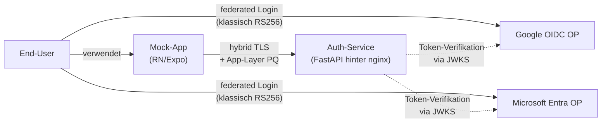

_Abbildung 10: System-Kontext mit Akteuren und Hauptverbindungen. Die "PQ-Uplift"-Grenze: Externe IdPs liefern klassisch signierte Tokens, ab dem Broker-Token ist alles PQ-sicher (ML-DSA-65)._

PQC wirkt bewusst auf zwei Ebenen. **Transport-Ebene:** nginx mit oqs-provider handelt X25519MLKEM768 mit jedem Client aus, der es unterstützt; das entspricht dem, was AWS, Cloudflare und Google ausrollen. **Applikations-Ebene:** Die App macht ihre eigene ML-KEM-768-Verkapselung gegen den Server, leitet per HKDF einen Session-Key ab und verschlüsselt Payloads mit AES-256-GCM. Das garantiert Ende-zu-Ende-PQ auch dann, wenn das OS-kontrollierte mobile TLS nicht PQ-fähig ist, und es ist der Teil, den ich tatsächlich selbst kontrollieren kann. Die Doppelung ist zugleich Defense-in-Depth: Ein Angreifer müsste beide Schichten brechen.

Vier Architektur-Leitsätze ziehen sich durch das Design ([`docs/07_design.md`](docs/07_design.md)): Krypto-Operationen laufen immer durch die Crypto-Abstraction-Layer (Application-Code kennt keine Algorithmus-Namen); externe IdPs sind austauschbare Plugins; PQ-Verschlüsselung ist Ende-zu-Ende auf Applikationsebene (TLS-PQ ist Zusatz-Schutz); und die Grenze zwischen klassischer Pre-Authentication und PQ-Sphäre ist klar definiert.

### 9.3 Komponenten-Architektur

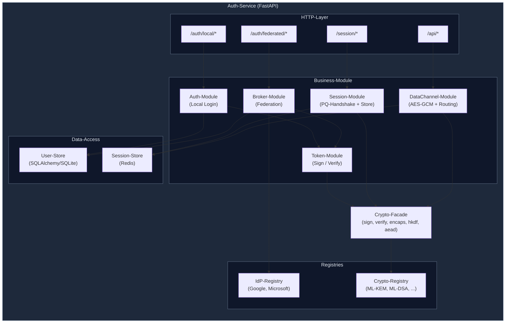

_Abbildung 11: Interne Komponenten des Auth-Service. Wichtigstes Merkmal: Die Module sprechen ausschliesslich mit der Crypto-Facade, nie direkt mit einer Krypto-Bibliothek._

Das Deployment besteht aus vier Containern in Docker Compose: nginx (TLS-Termination mit oqs-provider), auth-service (FastAPI mit liboqs-python), Redis (Session-Store) und dem Test-Runner. Details inklusive Netzwerk- und Volume-Layout in [`docs/07_design.md`](docs/07_design.md) Abschnitt 3, Setup-Anleitung im Top-Level-README.

### 9.4 Die PQ-Uplift-Grenze: eine ehrliche Limitation

Die erste Etappe der Federation (User zu Google/Microsoft) ist nicht PQ-sicher, weil beide Provider 2026 klassisch signierte ID-Tokens ausstellen. Das ist keine Schwäche der Architektur, sondern eine Limitation des heutigen Ökosystems, und sie ist bewusst eingeplant: Sobald die Provider PQC-Tokens ausstellen (realistisch 2028-2030), wird die Architektur ohne Code-Änderung Ende-zu-Ende PQ-sicher; nur die externen JWKS-Endpunkte liefern dann andere Schlüssel, was die Crypto-Abstraction-Layer transparent verarbeitet. Sicherheitstechnisch ist die klassische Pre-Auth 2026 vertretbar: Ein HNDL-Angreifer, der den Google-Login aufzeichnet, erbeutet in zehn Jahren einen längst abgelaufenen ID-Token; die eigentlichen Nutzdaten fliessen ausschliesslich durch die PQ-Session.

---
## 10. Implementierung

Dieses Kapitel zeigt die fünf zentralen Bausteine mit ausgewählten Nachweisen. Pro abgeschlossener Story existiert ein Evidence-File (`sprint_journal/sprint_<n>/evidence/`) mit Befehlen, Outputs und der Verifikation jedes Akzeptanzkriteriums; die Demos D-001 bis D-009 (Abschnitt 11.3) machen die Meilensteine reproduzierbar.

### 10.1 Crypto-Abstraction-Layer

Das Fundament der Crypto-Agility (UC-7) sind zwei Bausteine: eine **Crypto-Registry**, in der KEM- und Signatur-Implementierungen als Plugins registriert sind (liboqs-Adapter für ML-KEM-768/1024 und ML-DSA-65, gegen eine Whitelist geprüft, damit Tippfehler in der Config nicht stillschweigend durchlaufen), und eine **Crypto-Facade**, über die sämtliche Krypto-Operationen des Application-Codes laufen:

```python
class CryptoFacade:
    """Abstrakte Crypto-Operations-Schicht."""

    def sign(self, payload: bytes, purpose: str) -> tuple[bytes, str, str]:
        """Signiert payload mit dem Default-Signatur-Algorithmus."""
        alg = self._default_signature_alg          # kommt aus config.yaml
        plugin = self._registry.get_signature(alg) # Plugin-Lookup, kein Import
        signature = plugin.sign(payload, self._signing_secret_key)
        return signature, alg, self._signing_kid

    def verify(self, payload: bytes, signature: bytes, alg: str, kid: str) -> bool:
        public_key = self._verifying_keys_by_kid[kid]
        plugin = self._registry.get_signature(alg)
        return plugin.verify(payload, signature, public_key)
```

_Codeausschnitt aus `server/crypto/facade.py` (gekürzt): Der Application-Code ruft `sign()` auf, ohne zu wissen, welcher Algorithmus dahinter liegt._

Der Algorithmus-Wechsel läuft damit ausschliesslich über `config.yaml` (`crypto.signature.default`, `crypto.kem.supported`); jedes Krypto-Artefakt trägt seinen Algorithmus-Identifier mit sich (FR-Crypto-3), sodass alte Tokens nach einem Wechsel verifizierbar bleiben. Nachweis: Demo D-001, Evidence PQC-21/PQC-22/PQC-25.

### 10.2 Broker-Token mit ML-DSA-65

Der Broker-Token ist JWS-Compact-förmig aufgebaut (Header.Payload.Signatur, base64url), aber mit ML-DSA-65 statt RS256 signiert. Weil der IETF-Draft für PQC in JOSE noch nicht ratifiziert ist, wird der `alg`-Header projektspezifisch gesetzt und dokumentiert ([`docs/wire_format.md`](docs/wire_format.md) Abschnitt 2). Die Verifikation folgt den JWT Best Current Practices (RFC 8725): Algorithmus-Allowlist, explizites Ablehnen von `none`, Expiry-Check mit 30 Sekunden Leeway. Seit Sprint 4 sind Schlüssel-Rotation (TOK-3, mehrere `kid`s parallel gültig) und ein JWKS-Endpoint (TOK-4) umgesetzt. Nachweis: Demos D-002/D-003, 14 Tests im TokenService, Benchmark in 12.2.

### 10.3 Hybrides PQ-TLS server-seitig

nginx terminiert TLS mit OpenSSL 3 plus oqs-provider (Multi-Stage-Docker-Build ab `openquantumsafe/oqs-ossl3`), konfiguriert mit `ssl_ecdh_curve X25519MLKEM768:X25519:secp256r1;`, also PQ-hybrid bevorzugt mit klassischem Fallback. Den Handshake habe ich dreifach verifiziert: per `openssl s_client -groups X25519MLKEM768` (NamedGroup `0x11ec` in der Server-Antwort), im Chrome-Browser (Security-Panel zeigt X25519MLKEM768) und als reproduzierbare Demo D-005/D-007.

> **TODO (Dodoe):** Screenshot einfügen: Chrome-Security-Panel oder Terminal mit dem `openssl s_client`-Output, jeweils mit sichtbarem X25519MLKEM768. Beschriftung: _Abbildung: Nachweis des hybriden PQ-TLS-Handshakes._ Nummerierung danach im Abbildungsverzeichnis nachziehen. Wichtig für die Einordnung: Das Server-Zertifikat bleibt ECDSA, weil 2026 keine öffentliche CA ML-DSA-Zertifikate in der Breite ausstellt; PQ wirkt hier auf den Schlüsselaustausch (die dringende HNDL-Bedrohung), nicht auf die Zertifikats-Signatur.

### 10.4 PQ-Session und verschlüsselter Datenkanal

Nach dem Login etabliert die App die PQ-Session: Sie erzeugt ein ML-KEM-768-Schlüsselpaar, schickt den Encapsulation Key an `POST /session/init`, der Server verkapselt, leitet per HKDF (RFC 5869, salt=session_id, info="app-session-v1") einen 32-Byte-Session-Key ab und legt ihn mit TTL 900 s in Redis ab:

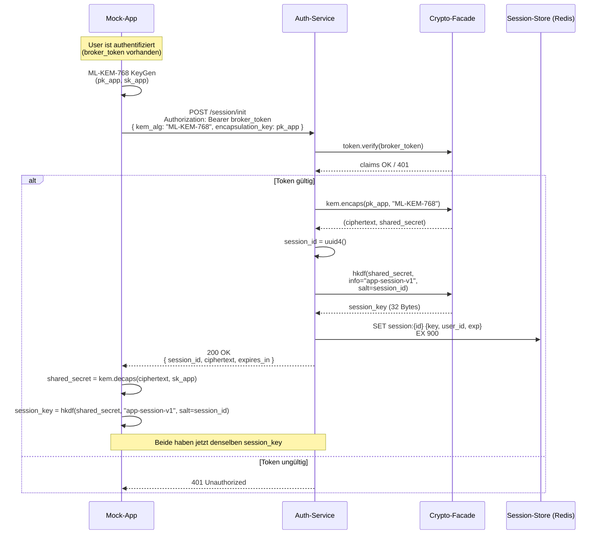

_Abbildung 12: Etablierung der PQ-Session (UC-4): ML-KEM-768-Schlüsselverkapselung mit HKDF-Ableitung des Session-Keys, vollständig über die Crypto-Facade._

Geschützte API-Calls laufen danach über den Datenkanal: AES-256-GCM-verschlüsselter Body, Session-Routing über die Header `X-Session-Id` und `X-Nonce`, AAD-Bindung an die Session-ID und atomarer Replay-Schutz (Redis `SET NX EX` pro Nonce, eine wiederverwendete Nonce ergibt `400 nonce_reused`). Das vollständige Wire-Format inklusive Fehler-Semantik und Algorithmus-Wechsel-Mechanik ist in [`docs/wire_format.md`](docs/wire_format.md) spezifiziert, das während der Implementierung als lebendes Architektur-Artefakt mitgewachsen ist (v0 bis v0.5).

### 10.5 Identity Broker

Der Federation-Flow konsumiert Google und Microsoft als OIDC-Provider über eine Plugin-Registry (UC-8: ein neuer Provider ist eine neue Plugin-Klasse plus Config, keine Architektur-Änderung). Der Flow ist ein Authorization Code Flow mit PKCE, State-Parameter gegen CSRF (128 Bit Entropie, Redis-seitig gespeichert) und ID-Token-Verifikation gegen die JWKS des Providers (Signatur, iss, aud, exp, email_verified):

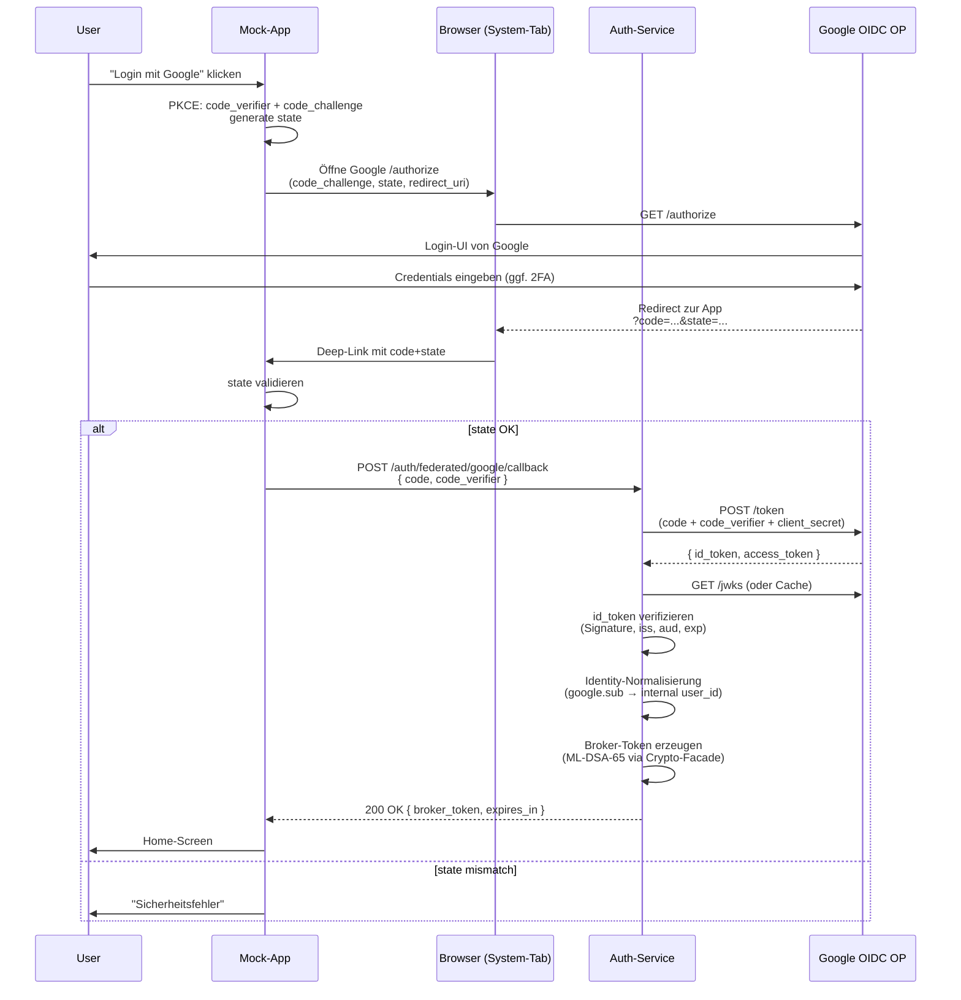

_Abbildung 13: Federated Login mit Google (UC-2): klassischer OIDC-Flow mit PKCE, am Ende der PQ-Uplift durch Ausstellung des ML-DSA-65-signierten Broker-Tokens._

Erwähnenswert ist die Microsoft-Registrierung als Single-Tenant-App: Sie vermeidet den App-Approval-Prozess für Multi-Tenant-Apps komplett. Diese kleine Entscheidung hat mir viel Wartezeit erspart (siehe Abschnitt 5.1).

### 10.6 Mobile-App

Die Expo-App (SDK 54, TypeScript) ist bewusst minimal: Login-Screen (lokal, Google, Microsoft), Home-Screen, Profile-Screen. Die Krypto-Seite nutzt `@noble/post-quantum` (auditiert, dependency-free) für ML-KEM-768 sowie `@noble/ciphers` für AES-256-GCM, den Broker-Token hält `expo-secure-store` im Plattform-Keystore. Zwei Bausteine kapseln die Komplexität: ein `SessionContext` (globaler Session-State) und `secureClient.ts`, ein HTTP-Wrapper, der Requests automatisch verschlüsselt und Responses entschlüsselt, sodass Screens normale Fetch-Semantik sehen. Die Kompatibilität der App-Krypto mit der Server-Krypto ist durch einen Cross-Validation-Vector abgesichert (identische HKDF-Ableitung auf beiden Seiten, F-098).

> **TODO (Dodoe):** Zwei Screenshots vom iPhone einfügen: (1) Login-Screen mit den drei Login-Optionen, (2) Profile-Screen mit angezeigten Profildaten und grünem Kanal-Status "ML-KEM-768" plus Session-ID. Beschriftungen: _Abbildung: Login-Screen der Mock-App_ und _Abbildung: Profile-Screen nach entschlüsselter Antwort über die PQ-Session._ Nummerierung danach im Abbildungsverzeichnis nachziehen.

---

## 11. Test und Qualitätssicherung

### 11.1 Teststrategie

Vier Ebenen, ergänzt durch einen Prozess: **Unit-Tests** pro Modul (Crypto-Adapter, TokenService, Session-Logik), **Integration-Tests** für die Flows (QUA-4: Broker-Flow mit gemocktem IdP), ein **End-to-End-Test** (QUA-5), der exakt die Kette der App nachfährt (Login, ML-KEM-Keypair, Session-Init, Decaps plus HKDF, AES-GCM-Request auf `/api/profile`, Response-Decrypt) mit fakeredis als einzigem Mock, sowie **Performance-Benchmarks** (QUA-6/7/8) gegen die NFR-Perf-Ziele. Der Prozess dazu: Vor jeder Done-Transition lief ein Closing-Review mit Test-Suite-Run und einem Audit nach zehn Sicherheits- und Qualitäts-Kategorien; funktionale Backend-Änderungen ohne automatisierten Test verletzten die Definition of Done.

### 11.2 Testprotokoll und Nachweise

Der finale Container-Testlauf (07.07.2026): **420 Tests passed, 0 failed in 22.85 s** (`docker compose run --rm auth-service-test`). Die Coverage auf den Auth-Modulen wurde in Sprint 1 mit 85% gemessen und übererfüllt das SMART-Ziel von 80% (QUA-2). Der E2E-Test deckt neben dem Happy-Path drei Negativ-Szenarien ab: Replay-Detection (gleiche Nonce zweimal ergibt `400 nonce_reused`), unbekannte Session (`401`) und Multi-Session-Isolation (Cross-Use zweier Session-Keys ergibt `400 aead_decrypt_failed`). Das AC-für-AC-Testprotokoll pro Story liegt in den Evidence-Files, z.B. [`PQC-67_QUA-5_end_to_end_integration_test.md`](sprint_journal/sprint_4/evidence/PQC-67_QUA-5_end_to_end_integration_test.md).

### 11.3 Demos als reproduzierbare Nachweise

| Demo | Inhalt | Sprint |
|---|---|---|
| D-001 | Crypto-Foundation (Registry, Facade, liboqs ML-DSA-65) | 1 |
| D-002 / D-003 | Broker-Token ausstellen / verifizieren | 1 |
| D-004 | Lokale Login-Pipeline End-to-End | 1 |
| D-005 | PQC-TLS-Handshake (openssl s_client, NamedGroup 0x11ec) | 1 |
| D-006 | Mobile Login-Screen auf iPhone (Expo Go) | 1 |
| D-007 | PQ-TLS-Handshake-Verifikation (Browser plus oqs-curl) | 2 |
| D-008 | End-to-End-Roundtrip Server-Pfad (8 Schritte, Script) | 3 |
| D-009 | Mobile End-to-End-Demo (Login bis entschlüsseltes Profil) | 4 |

_Tabelle 22: Demo-Verzeichnis; jede Demo ist als Befehlsfolge mit erwarteten Outputs in `sprint_journal/sprint_<n>/demos/` dokumentiert_

---

## 12. Ergebnis und Abnahme

### 12.1 Zielerreichung

Alle fünf SMART-Ziele aus dem Abschnitt 1.4 sind erreicht:

1. **Auth-Microservice mit PQ-Token: erreicht.** FastAPI-Service mit lokalem Login und Admin-CLI-Provisioning stellt ML-DSA-65-signierte Broker-Tokens aus. Messnachweis: 420 Tests grün, 85% Coverage auf den Auth-Modulen (Ziel: mind. 20 Tests, 80%).
2. **Hybrides PQ-TLS server-seitig: erreicht.** nginx handelt X25519MLKEM768 aus; NamedGroup `0x11ec` per `openssl s_client` und Chrome verifiziert (D-005, D-007).
3. **End-to-End-PQ-Demo: erreicht.** Die Expo-App durchläuft Login, ML-KEM-768-Session und AES-GCM-verschlüsselten `/api/profile`-Call mit `200 OK` und korrekt entschlüsseltem Body, live auf dem iPhone (D-009) und automatisiert als E2E-Test (QUA-5).
4. **Identity-Broker mit PQ-Uplift: mit Einschränkung erreicht.** Der Federation-Login via Google und Microsoft funktioniert End-to-End über den Browser-Pfad gegen das Backend, inklusive Überführung der Claims in ML-DSA-signierte Broker-Tokens. In der Mobile-App selbst liess sich der Federation-Login in der Abschluss-Demo nicht durchgängig abschliessen; mobil verifiziert sind der lokale Login und die komplette PQ-Session. Diese Lücke bleibt offen benannt.
5. **Crypto-Agility: grösstenteils erreicht.** Die Mechanik ist implementiert und durch Tests abgesichert: Algorithmen werden ausschliesslich über `config.yaml` bestimmt, jedes Krypto-Artefakt trägt seinen Algorithmus-Identifier, unbekannte Algorithmen scheitern kontrolliert an der Whitelist, und die Algorithmus-Negotiation liefert bei nicht unterstütztem KEM ein sauberes 406. Den demonstrativen End-to-End-Wechsel (z.B. auf ML-KEM-1024) habe ich aus Zeitgründen nicht mehr als eigene Demo durchgeführt; dieselbe Grenze zeigt sich im Benchmark (Abschnitt 12.2), wo nur ML-KEM-768 registriert war.

### 12.2 Performance-Resultate

Die drei messbaren NFR-Perf-Ziele wurden mit Benchmarks nachgewiesen (Methodik, Rohdaten und Interpretation in [`docs/14_performance_results.md`](docs/14_performance_results.md)):

| Messung | Ziel (NFR) | Gemessen (P50 / P95) | Resultat |
|---|---|---|---|
| PQ-Session-Etablierung (POST /session/init, ML-KEM-768) | < 500 ms | 2.5 ms / 4.8 ms | PASS, Faktor 100 Marge |
| Broker-Token-Verifikation (ML-DSA-65, voll inkl. JWS-Parsing) | < 10 ms | 0.54 ms / 0.80 ms | PASS, Faktor 12 Marge |
| AES-GCM-Overhead pro API-Call (bis 10 KiB Payload) | < 50 ms | 0.22 ms / 0.78 ms | PASS, Faktor 64 Marge |

_Tabelle 23: Performance-Resultate gegen die NFR-Perf-Ziele (100 bis 1000 Mess-Iterationen nach Warmup, Container-Setup)_

Die für mich wichtigste Erkenntnis daraus: PQC ist auf dieser Systemgrösse kein Performance-Problem. Die ML-DSA-Verifikation kostet unter einer Millisekunde, und der Verschlüsselungs-Overhead ist sogar kleiner als der Framework-Overhead eines simplen Health-Checks.

### 12.3 Installation und Inbetriebnahme

Das System startet mit Docker Compose: Repo klonen, `.env` mit den OAuth-Credentials befüllen (Anleitung inklusive Google-Cloud-Console- und Azure-Portal-Schritten im [`server/README.md`](server/README.md)), `docker compose up` im `infra/`-Verzeichnis, Test-User per Admin-CLI anlegen. Die Schritt-für-Schritt-Anleitung inklusive Voraussetzungen steht im [`infra/README.md`](infra/README.md) (Quickstart); die Mobile-App startet mit `npx expo start` und Expo Go. Für die Abnahme relevant: Der komplette Demo-Pfad ist zusätzlich zur manuellen Anleitung automatisiert reproduzierbar (D-008-Script, QUA-5-Test im Container).

### 12.4 Übergabe und offene Punkte

Übergeben werden das GitHub-Repo (Code, Doku, ADRs, Sprint-Journal), das Jira-Projekt und diese Dokumentation; die Live-Demo lief im Kolloquium am 08.07.2026 erfolgreich (Demo D-009). Bewusst nicht umgesetzt sind die drei Stretch-Stories (Hybrid-Key-Combiner auf App-Layer, Apple Sign In, selbstsignierte ML-DSA-Zertifikats-Demo, zusammen 18 SP), sie waren als Could priorisiert und wurden zugunsten der Doku-Qualität nicht gezogen. Zwei kleine Findings aus dem letzten Closing-Review sind als Nachverfolgungs-Stories dokumentiert (PQC-85, PQC-86), inklusive des empfohlenen Fixes (einheitliche `authentication_failed`-Response, siehe Kapitel 13). Ebenfalls bewusst zurückgestellt ist der Ausbau des Top-Level-READMEs zu einer vollständigen Produkt-Setup-Anleitung (PQC-73); die funktionierende Inbetriebnahme-Anleitung liegt in `infra/README.md` und `server/README.md` (siehe 12.3).

---

## 13. Reflexion und offene Punkte

**Abgewogene Varianten.** Die grösste Entscheidung (drei Architektur-Optionen, Abschnitt 4.1) ist dokumentiert und hat sich als richtig erwiesen: Der Broker-Ansatz hat genau die Balance zwischen PQC-Tiefe und Realitäts-Anker geliefert, die die Arbeit tragfähig macht. Auch kleinere Abwägungen sind festgehalten: liboqs-python statt pyca/cryptography (das ML-DSA 2026 noch nicht shipped) auf dem Server, `@noble/post-quantum` statt eines pre-standardization Native-Moduls auf Mobile, Single-Tenant statt Multi-Tenant bei Microsoft, JWS-förmiges Token-Format trotz nicht ratifiziertem JOSE-PQC-Draft (dokumentierte Projekt-Konvention statt Pseudo-Standard).

**Vorbehalte der eigenen Lösung.** Vier Punkte sind offen zu benennen. Erstens R-T08: Der mobile TLS-Transport blieb im Projekt klassisch, weil die OS-TLS-Stacks ML-KEM nicht unterstützten (mit iOS 26 beginnt sich das aufzulösen, siehe Abschnitt 5.2); die PQ-Sicherheit der App-Kommunikation hängt damit vollständig an der Application-Layer-Session, was genau der Grund ist, warum sie existiert. Zweitens demonstriert die Arbeit standardisierte Algorithmen, aber keine FIPS-140-3-validierten Implementierungen (liboqs ist nicht validiert); für Produktion wäre das ein eigenes Arbeitspaket. Drittens ist die klassische Pre-Auth der Federation eine bewusste, zeitlich begrenzte Lücke (Abschnitt 9.4). Viertens bleiben zwei kleine Review-Findings offen (PQC-85/86), transparent dokumentiert statt stillschweigend ignoriert.

**Erkenntnisse.** Drei Dinge nehme ich fachlich aus dieser Arbeit mit. Erstens: Die PQ-Migration ist 2026 auf der Schlüsselaustausch-Seite praktisch schmerzfrei (Performance-Marge Faktor 100, ausgereiftes Tooling), auf der Signatur- und Ökosystem-Seite dagegen noch Pionierarbeit. Zweitens: Crypto-Agility hat sich im Projekt dreimal konkret ausgezahlt (Algorithmus-Wechsel-Demo, Schlüssel-Rotation, Whitelist-Fehlerfälle), das Prinzip ist also mehr als Theorie. Drittens: Die grösste Umstellung war für mich nicht die Mathematik, sondern die Grösse der Artefakte, mit 3.3-KB-Signaturen und 1.2-KB-Key-Shares muss man anders umgehen als mit 64 Bytes ECDSA.

**Handlungsempfehlungen.** Für Organisationen, die heute starten wollen: hybrides PQ-TLS server-seitig aktivieren (Browser können es längst), eigene Token-Signaturen über eine Crypto-Abstraction führen (dann ist ML-DSA ein Config-Eintrag, sobald das Umfeld bereit ist), für mobile Ende-zu-Ende-Anforderungen eine Application-Layer-PQ-Session als Brücke erwägen, und drei Entwicklungen beobachten: ML-KEM-Support in den OS-TLS-Stacks, ML-DSA-Zertifikate öffentlicher CAs und die Ratifizierung von PQC in JOSE. Für die Weiterentwicklung dieses Projekts wären die nächsten sinnvollen Schritte der Hybrid-Key-Combiner auf App-Layer (STR-1) und ein FIPS-validierter Krypto-Provider, sobald verfügbar.

---

---

## 14. Anhang und Verzeichnisse

### Zentrale Referenzen

| Artefakt | Ort |
|---|---|
| Jira-Projekt (Backlog, Sprints, Worklogs) | [rumidesigns.atlassian.net, Projekt PQC](https://rumidesigns.atlassian.net/jira/software/projects/PQC/backlog) |
| GitHub-Repository (Code, Doku, Journal) | Repo `rib-pqc`, Top-Level-README mit Setup-Anleitung |
| Sprint-Journal (Planning, Review, Retro, Daily) | [`sprint_journal/`](sprint_journal/) |
| Evidence-Files pro Story | `sprint_journal/sprint_<n>/evidence/` |
| Demos D-001 bis D-009 | `sprint_journal/sprint_<n>/demos/` |
| Konzept-Dokumente (Requirements, Design, Backlog, Risk Register) | [`docs/`](docs/) |
| Mentor-Kommunikation | [`sprint_journal/mentor_meetings/`](sprint_journal/mentor_meetings/) |

_Tabelle 24: Zentrale Projekt-Referenzen_

### Repository-Navigation und Setup

| Verzeichnis | Inhalt |
|---|---|
| `abgabe/` | Verweis auf diesen Schlussbericht |
| `docs/` | Konzept-Dokumente: Architektur-Entscheidung, Requirements, Design, Tech-Stack, Scrum-Setup, Backlog, Risk Register, Traceability, Performance-Resultate, ADRs |
| `sprint_journal/` | Planning, Daily Journal, Review, Retrospektive, Evidence und Demos pro Sprint, Mentor-Updates |
| `server/` | Auth-Service (Python 3.12, FastAPI, liboqs-python) |
| `app/` | Mobile-App (React Native Expo, TypeScript, @noble/post-quantum) |
| `infra/` | Docker Compose, nginx mit oqs-provider (Setup-Quickstart im dortigen README) |
| `praesentation/` | Kolloquiums-Folien und Demo-Runbook |

Setup-Kurzfassung: `docker compose up` im `infra/`-Verzeichnis (Details und Voraussetzungen im [`infra/README.md`](infra/README.md)), OAuth-Credentials gemäss [`server/README.md`](server/README.md), App via `npx expo start` und Expo Go. Demo-Ablauf: [`sprint_journal/sprint_4/demos/D-009_mobile_end_to_end.md`](sprint_journal/sprint_4/demos/D-009_mobile_end_to_end.md).

### Glossar

Gemeinsames Glossar für beide Dokumente. Definiert PQC- und projektspezifische Begriffe, gängige Grundbegriffe (TLS, RSA, ECDSA) werden vorausgesetzt.

| Begriff | Definition |
|---|---|
| Post-Quantum Cryptography (PQC) | Kryptografische Verfahren, die auch gegen Angriffe mit Quantencomputern sicher sind. |
| Shors Algorithmus | Quantenalgorithmus, der die mathematischen Probleme hinter RSA und ECC effizient löst und diese damit brechbar macht. |
| Harvest Now, Decrypt Later (HNDL) | Angriffsmodell: heute verschlüsselten Verkehr aufzeichnen und später mit einem Quantencomputer entschlüsseln. |
| ML-KEM (FIPS 203) | NIST-Standard für quantensicheren Schlüsselaustausch (Key Encapsulation Mechanism), basierend auf CRYSTALS-Kyber. |
| ML-DSA (FIPS 204) | NIST-Standard für quantensichere digitale Signaturen, basierend auf CRYSTALS-Dilithium. |
| SLH-DSA (FIPS 205) | Hash-basierter NIST-Signaturstandard, als konservatives Backup zu ML-DSA. |
| KEM | Key Encapsulation Mechanism: Verfahren, um über einen unsicheren Kanal einen gemeinsamen symmetrischen Schlüssel zu etablieren. |
| Hybrider Schlüsselaustausch (X25519MLKEM768) | Kombination aus klassischem (X25519) und post-quantum (ML-KEM-768) Schlüsselaustausch; sicher, solange mindestens eines der beiden Verfahren hält. |
| oqs-provider / liboqs | Open-Source-Bausteine des Open-Quantum-Safe-Projekts, die PQC-Algorithmen in OpenSSL und nginx einbringen. |
| HKDF (RFC 5869) | Schlüsselableitungs-Funktion: macht aus einem gemeinsamen Geheimnis einen kryptografisch sauberen Session-Key. |
| AEAD / AES-256-GCM | Authenticated Encryption: verschlüsselt Nutzdaten und schützt sie gleichzeitig vor Manipulation; gilt als quantensicher genug. |
| Nonce / Replay-Schutz | Einmalwert pro verschlüsselter Nachricht; der Server lehnt wiederverwendete Nonces ab, damit aufgezeichnete Requests nicht erneut eingespielt werden können. |
| JWS / JWKS | JSON Web Signature (Token-Format Header.Payload.Signatur) und JSON Web Key Set (Endpoint, der die öffentlichen Schlüssel zur Verifikation liefert). |
| PKCE | Proof Key for Code Exchange: Schutz des OAuth-Authorization-Code-Flows gegen Code-Interception, Pflicht für mobile Apps. |
| OIDC (OpenID Connect) | Standardprotokoll für Authentifizierung über externe Identity Provider wie Google oder Microsoft. |
| Identity Broker | Komponente, die externe Identitäten annimmt und in projekteigene, hier PQ-sichere, Sessions überführt. |
| PQ-Uplift | In diesem Projekt: das Anheben einer klassisch authentifizierten Identität auf eine post-quantum-sichere Session. |
| Crypto-Agility | Architektur-Prinzip, das den Austausch kryptografischer Algorithmen ohne Code-Änderung erlaubt. |
| Argon2id | Passwort-Hashing-Verfahren (OWASP-Empfehlung), das Brute-Force-Angriffe durch Speicher- und Zeitkosten bremst. |
| Definition of Done (DoD) | Projektweite Qualitäts-Checkliste, die jede Story zusätzlich zu ihren Akzeptanzkriterien erfüllen muss. |
| Akzeptanzkriterien | Storyspezifische, nachprüfbare Bedingungen, die die fachliche Korrektheit genau einer Story belegen. |
| Definition of Ready (DoR) | Eingangslatte: Bedingungen, die eine Story erfüllen muss, bevor sie in einen Sprint geplant wird. |
| Story Points / T-Shirt-Sizing | Relatives Schätzmass für Aufwand (XS bis XL, abgebildet auf die Fibonacci-Folge) statt absoluter Stunden. |
| Velocity | Pro Sprint abgeschlossene Story Points; bei Einzelarbeit nur eingeschränkt aussagekräftig. |
| AI-Multiplier (projektspezifisch) | Verhältnis aus klassischer Schätzung ohne AI zu tatsächlicher Arbeitszeit mit AI-Unterstützung, am Projektende ausgewertet. |
| MoSCoW | Priorisierungsmethode: Must, Should, Could, Won't. |
| MVP / MLP / MMP | Release-Stufen: Minimum Viable (früh Feedback), Minimum Lovable (Qualität), Minimum Marketable (Abgabe). |
| Epic | Übergeordnete Arbeitseinheit im Backlog, die mehrere thematisch zusammengehörige Stories bündelt. |
| Roadmap | Grobe zeitliche Übersicht der Releases und Meilensteine, nicht die Detailplanung. |
| Evidence-File | In diesem Projekt eingeführte Markdown-Notiz pro Story, die belegt, wie jedes Akzeptanzkriterium erfüllt wurde. |

### Quellenverzeichnis

Auswahl der zentralen Quellen; das vollständige, kommentierte Verzeichnis mit allen im Projekt verwendeten Quellen steht in [`docs/04_quellen.md`](docs/04_quellen.md).

| Quelle | Verwendung |
|---|---|
| [NIST FIPS 203: ML-KEM](https://csrc.nist.gov/pubs/fips/203/final) | Schlüsselverkapselung (Abschnitte 7.2, 10.4) |
| [NIST FIPS 204: ML-DSA](https://csrc.nist.gov/pubs/fips/204/final) | Token-Signaturen (Abschnitte 7.2, 10.2) |
| [NIST FIPS 205: SLH-DSA](https://csrc.nist.gov/pubs/fips/205/final) | Backup-Signaturverfahren, Abgrenzung (7.2) |
| [NIST CSWP 39: Crypto Agility](https://csrc.nist.gov/pubs/cswp/39/considerations-for-achieving-cryptographic-agility/final) | Crypto-Agility-Prinzip (10.1) |
| [IETF draft-ietf-tls-ecdhe-mlkem](https://datatracker.ietf.org/doc/draft-ietf-tls-ecdhe-mlkem/) | Hybrider TLS-Schlüsselaustausch (7.3, 10.3) |
| [IETF draft-ietf-jose-pqc](https://datatracker.ietf.org/doc/draft-ietf-jose-pqc/) | Einordnung Token-Format (10.2) |
| [RFC 5869: HKDF](https://datatracker.ietf.org/doc/html/rfc5869) | Session-Key-Ableitung (10.4) |
| [RFC 8725: JWT Best Current Practices](https://datatracker.ietf.org/doc/html/rfc8725) | Token-Verifikation (10.2) |
| [RFC 6749: OAuth 2.0](https://datatracker.ietf.org/doc/html/rfc6749) / [OpenID Connect Core 1.0](https://openid.net/specs/openid-connect-core-1_0.html) | Federation-Flow (10.5) |
| [liboqs / oqs-provider / liboqs-python](https://github.com/open-quantum-safe) | Server-seitige PQC-Implementierung (10.1, 10.3) |
| [@noble/post-quantum](https://github.com/paulmillr/noble-post-quantum) | Mobile PQC-Implementierung (10.6) |
| Identity-Broker-Pattern: [Red Hat](https://docs.redhat.com/en/documentation/red_hat_build_of_keycloak/), [Zitadel](https://zitadel.com/docs/concepts/features/identity-brokering), AWS Cognito | Architektur-Vorbild (9.1, 10.5) |

### Abbildungsverzeichnis

| Nr. | Titel | Abschnitt |
|---|---|---|
| Abbildung 1 | Gantt-Chart mit Sprints, Releases und Meilensteinen | 3.2 |
| Abbildung 2 | Sprint-1-Burndown (Jira) | 4.2 |
| Abbildung 3 | Sprint-2-Burndown (Jira) | 4.3 |
| Abbildung 4 | Sprint-3-Burndown (Jira) | 4.4 |
| Abbildung 5 | Sprint-4-Burndown (Jira) | 4.5 |
| Abbildung 6 | Risikomatrix | 5 |
| Abbildung 7 | Das KEM-Prinzip (FIPS 203) | 7.2 |
| Abbildung 8 | Signieren und Verifizieren mit ML-DSA-65 (FIPS 204) | 7.2 |
| Abbildung 9 | Hybrider TLS-1.3-Handshake mit X25519MLKEM768 | 7.3 |
| Abbildung 10 | System-Kontext mit Akteuren und Hauptverbindungen | 9.2 |
| Abbildung 11 | Interne Komponenten des Auth-Service | 9.3 |
| Abbildung 12 | Etablierung der PQ-Session (UC-4) | 10.4 |
| Abbildung 13 | Federated Login mit Google (UC-2) | 10.5 |

> **TODO (Dodoe):** Nach dem Einfügen der restlichen Screenshots (TLS-Nachweis in 10.3, App-Screens in 10.6) hier nachtragen und durchnummerieren.

### Tabellenverzeichnis

| Nr. | Titel | Abschnitt |
|---|---|---|
| Tabelle 1 | Stakeholder und ihre Hauptinteressen | 1.3 |
| Tabelle 2 | Scrum-Events in der Solo-Adaption | 2.2 |
| Tabelle 3 | Release-Stufen mit Meilenstein-Bindung | 3.1 |
| Tabelle 4 | MoSCoW-Verteilung des Backlogs | 3.4 |
| Tabelle 5 | SWOT-Analyse | 3.6 |
| Tabelle 6 | Retrospektive Sprint 0 | 4.1 |
| Tabelle 7 | Sprint-1-Lieferumfang nach Epic | 4.2 |
| Tabelle 8 | Retrospektive Sprint 1 | 4.2 |
| Tabelle 9 | Sprint-2-Lieferumfang nach Epic | 4.3 |
| Tabelle 10 | Retrospektive Sprint 2 | 4.3 |
| Tabelle 11 | Sprint-3-Lieferumfang nach Epic | 4.4 |
| Tabelle 12 | Retrospektive Sprint 3 | 4.4 |
| Tabelle 13 | Sprint-4-Lieferumfang | 4.5 |
| Tabelle 14 | Retrospektive Sprint 4 | 4.5 |
| Tabelle 15 | Risiko-Übersicht mit Bewertung und Status | 5 |
| Tabelle 16 | Top-Risiken mit Massnahmen und Wirkung | 5.1 |
| Tabelle 17 | Velocity und AI-Multiplier pro Sprint | 6.1 |
| Tabelle 18 | Zwei Quanten-Bedrohungen mit unterschiedlicher Dringlichkeit | 7.1 |
| Tabelle 19 | Grössenvergleich PQC gegen klassische Kryptografie | 7.2 |
| Tabelle 20 | Use-Case-Übersicht mit MoSCoW-Priorität | 8 |
| Tabelle 21 | Vergleich der drei Architektur-Optionen | 9.1 |
| Tabelle 22 | Demo-Verzeichnis | 11.3 |
| Tabelle 23 | Performance-Resultate gegen die NFR-Perf-Ziele | 12.2 |
| Tabelle 24 | Zentrale Projekt-Referenzen | 14 |
