# Design: PQC Auth-Service mit Identity Broker und E2E PQ-Kommunikation

**Projekt:** Implementing PQC (Semesterarbeit 3, ITCNE25)
**Autor:** Dodoe Rumiñahui Mannale
**Erstellt:** 08.05.2026
**Status:** Initial-Version (v1.0)

**Bezug:** Konkretisiert die Architektur aus `03_entscheidung_auth_architektur.md` und implementiert die Requirements aus `05_requirements.md` mit dem Tech-Stack aus `06_tech_stack.md`.

---

## Inhaltsverzeichnis

1. [Übersicht und System-Kontext](#1-übersicht-und-system-kontext)
2. [Komponenten-Architektur](#2-komponenten-architektur)
3. [Deployment-Architektur](#3-deployment-architektur)
4. [Sequenz-Diagramme](#4-sequenz-diagramme)
5. [Datenmodell](#5-datenmodell)
6. [Crypto-Abstraction-Layer Design](#6-crypto-abstraction-layer-design)
7. [Versionsverlauf](#7-versionsverlauf)

---

## 1. Übersicht und System-Kontext

### 1.1 System-Kontext

Das System besteht aus zwei Hauptkomponenten (Mock-App und Auth-Service) und nutzt zwei externe Identity Provider (Google, Microsoft) für die Federation. Die folgende Übersicht zeigt die Akteure und Hauptverbindungen:

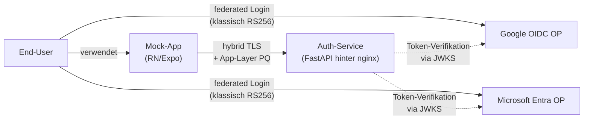

### 1.2 Architektur-Leitsätze

Das Design folgt vier Leitsätzen:

- **Krypto-Operationen laufen IMMER durch die Crypto-Abstraction-Layer.** Application-Code kennt keine konkreten Algorithmus-Namen.
- **Externe IdPs sind austauschbare Plugins.** Apple kann später hinzugefügt werden ohne Architektur-Änderung.
- **PQ-Verschlüsselung ist End-to-End auf Application-Layer.** TLS-PQ ist Zusatz-Schutz, nicht primärer Verschlüsselungskanal.
- **Trennung von klassischer Pre-Authentication (extern) und PQ-Sphäre (intern).** Die "PQ-Uplift"-Grenze ist klar definiert: ab dem Broker-Token ist alles PQ-sicher.

---

## 2. Komponenten-Architektur

### 2.1 Auth-Service: Interne Komponenten

Der Auth-Service ist intern in Module gegliedert, die jeweils klar definierte Verantwortungen haben:

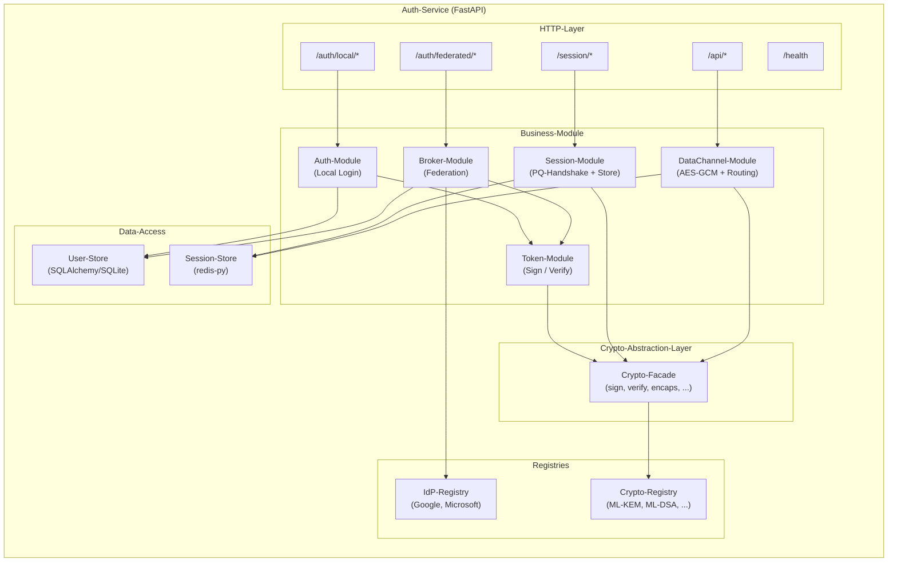

**Verantwortlichkeiten pro Modul:**

| Modul | Verantwortlichkeit | Erfüllt FR |
|---|---|---|
| Auth-Module | Lokale Email/Passwort-Authentifizierung | FR-Auth-1, FR-Auth-2 |
| Broker-Module | Federation-Flow mit externen IdPs, Identity-Normalisierung | FR-Broker-1 bis FR-Broker-4 |
| Token-Module | Broker-Token-Ausstellung und -Verifikation | FR-Token-1, FR-Token-2, FR-Token-3 |
| Session-Module | PQ-Session-Etablierung, Session-Lifecycle | FR-Session-1 bis FR-Session-4 |
| DataChannel-Module | Verschlüsselter Daten-Kanal für API-Calls | FR-DataChannel-1, FR-DataChannel-2 |
| IdP-Registry | Plugin-Registry für externe OIDC-Provider | FR-Broker-1 |
| Crypto-Registry | Plugin-Registry für KEM- und Signatur-Algorithmen | FR-Crypto-1 |
| Crypto-Facade | Abstrakte Schnittstelle zu allen Krypto-Operationen | FR-Crypto-2, FR-Crypto-3 |

### 2.2 Mobile-App: Interne Komponenten

Die Mock-App ist als TypeScript-Expo-App strukturiert:

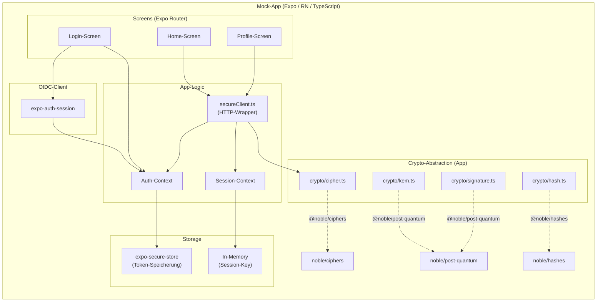

**Verantwortlichkeiten:**

| Komponente | Verantwortlichkeit |
|---|---|
| Login-Screen | Drei Login-Optionen (Email/Passwort, Google, Microsoft) |
| Home-Screen | Demonstration eines geschützten API-Calls nach erfolgreichem Login |
| Profile-Screen | Anzeige der eigenen User-Daten via PQ-verschlüsseltem `/api/profile`-Call |
| Auth-Context | Globaler State für Broker-Token und User-Info |
| Session-Context | Globaler State für aktuelle PQ-Session (session_id, session_key) |
| secureClient.ts | HTTP-Wrapper, der jede API-Anfrage automatisch verschlüsselt und entschlüsselt |
| crypto/* | Eigene Abstraction-Module über die `@noble/*` Libraries |

---

## 3. Deployment-Architektur

### 3.1 Container-Setup (Docker Compose)

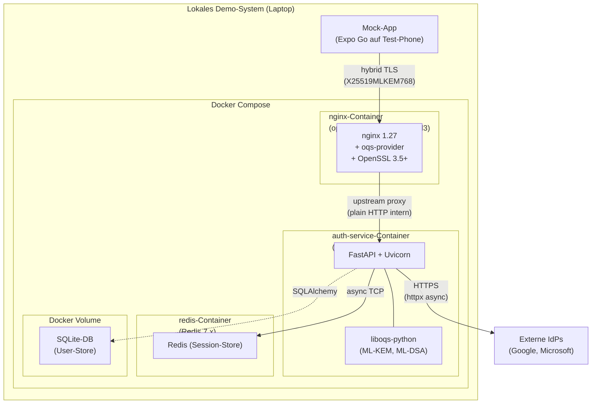

### 3.2 Netzwerk- und Port-Layout

| Komponente | Port (intern) | Port (extern) | Protokoll |
|---|---|---|---|
| nginx | 443 | 443 | HTTPS mit X25519MLKEM768 |
| auth-service (Uvicorn) | 8000 | n.A. (nur intern) | HTTP |
| redis | 6379 | n.A. (nur intern) | RESP-Protokoll |
| SQLite | n.A. (File-DB) | n.A. | n.A. |

### 3.3 Volumes und Persistenz

- `auth-data`: Docker-Volume für die SQLite-DB. Persistiert User-Records über Container-Restarts.
- `redis-data` (optional): Docker-Volume für Redis-Persistenz. Sessions überleben Redis-Restart, sterben aber bei vollständigem Compose-Down.

---

## 4. Sequenz-Diagramme

### 4.1 UC-1: Lokaler Login mit Email/Passwort

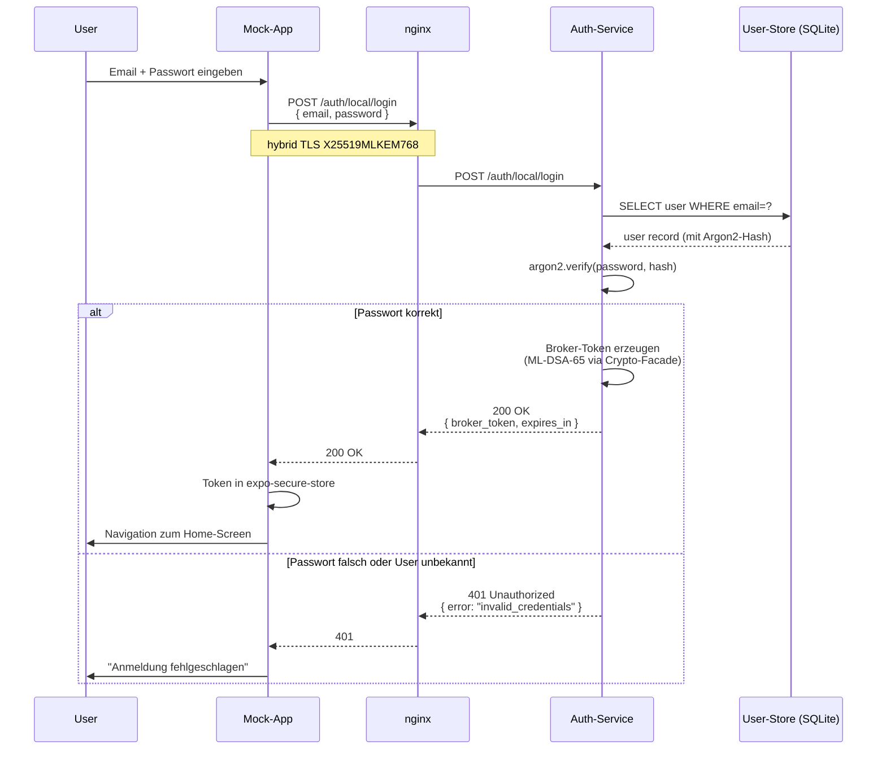

### 4.2 UC-2: Login mit Google (Federated)

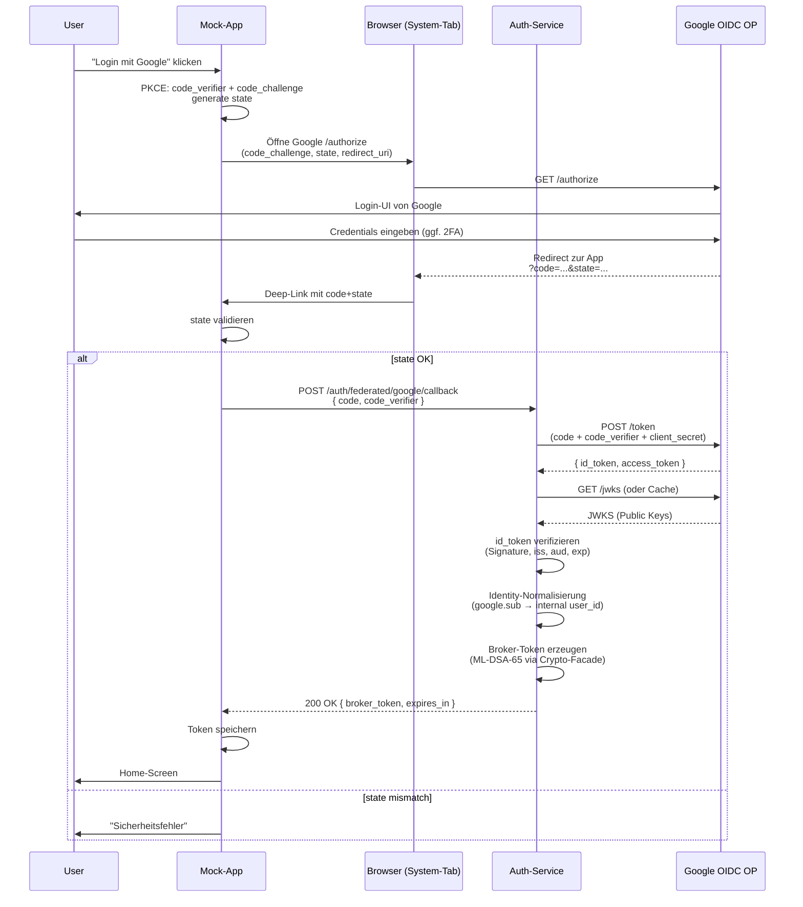

### 4.3 UC-4: Etablierung der PQ-Session

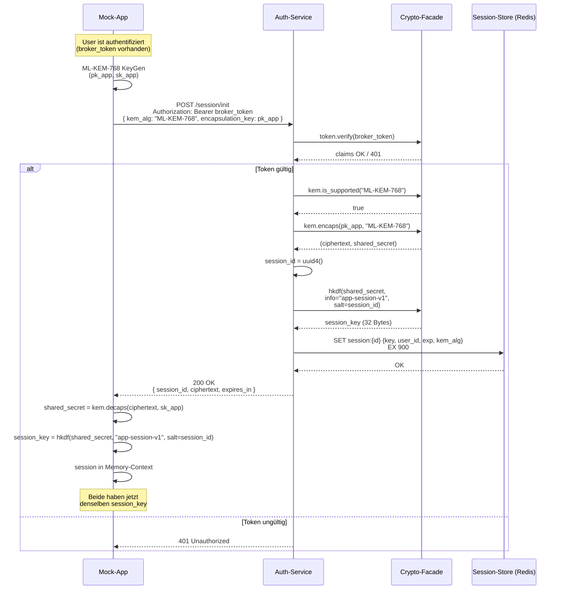

### 4.4 UC-5: Geschützter API-Call

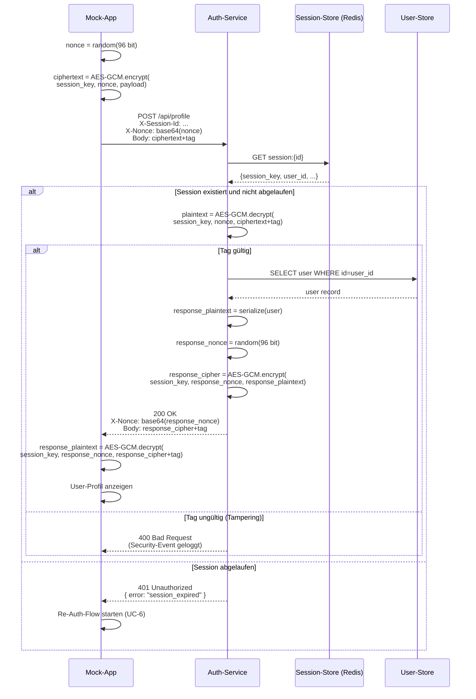

### 4.5 UC-7: Algorithmus-Wechsel via Config

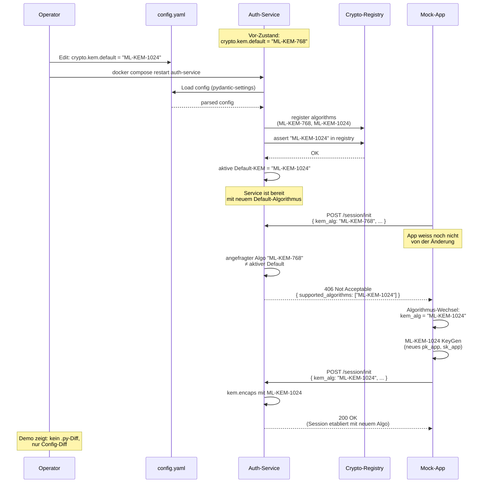

---

## 5. Datenmodell

### 5.1 Broker-Token-Struktur (intern, JWS-shaped mit ML-DSA)

Der Broker-Token folgt der JWS-Compact-Serialization aus RFC 7515:

```
base64url(header) . base64url(payload) . base64url(signature)
```

**Header:**

```json
{
  "alg": "ML-DSA-65",
  "typ": "JWT",
  "kid": "key-2026-05-1"
}
```

**Payload (Claims):**

```json
{
  "sub": "user-uuid-...",
  "iss": "pqc-auth-service",
  "iat": 1746700800,
  "exp": 1746704400,
  "auth_method": "local",
  "external_sub": null
}
```

Bei federated Logins:

```json
{
  "sub": "user-uuid-...",
  "iss": "pqc-auth-service",
  "iat": 1746700800,
  "exp": 1746704400,
  "auth_method": "google",
  "external_sub": "115234567890123456789"
}
```

**Signatur:** ML-DSA-65 über die Bytes von `base64url(header).base64url(payload)`.

### 5.2 Session-Record (Redis)

Key: `session:{session_id}`
Value (JSON-serialisiert):

```json
{
  "session_key": "base64-encoded-32-bytes",
  "user_id": "user-uuid-...",
  "kem_alg": "ML-KEM-768",
  "created_at": 1746700800,
  "expires_at": 1746701700
}
```

TTL via Redis EXPIRE auf 900 Sekunden (15 Minuten Default).

### 5.3 User-Record (SQLite)

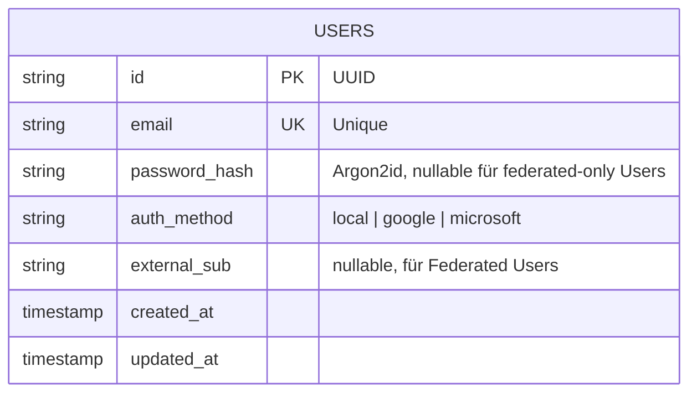

### 5.4 Config-Struktur (`config.yaml`)

```yaml
crypto:
  kem:
    default: "ML-KEM-768"
    supported:
      - "ML-KEM-768"
      - "ML-KEM-1024"
  signature:
    default: "ML-DSA-65"
    supported:
      - "ML-DSA-65"
  symmetric:
    cipher: "AES-256-GCM"
    kdf: "HKDF-SHA256"

token:
  ttl_seconds: 3600
  issuer: "pqc-auth-service"
  active_kid: "key-2026-05-1"

session:
  ttl_seconds: 900

idp_providers:
  google:
    client_id: "${GOOGLE_CLIENT_ID}"
    discovery_url: "https://accounts.google.com/.well-known/openid-configuration"
    scopes: ["openid", "email", "profile"]
    claim_mapping:
      external_sub: "sub"
  microsoft:
    client_id: "${MICROSOFT_CLIENT_ID}"
    discovery_url: "https://login.microsoftonline.com/common/v2.0/.well-known/openid-configuration"
    scopes: ["openid", "email", "profile"]
    claim_mapping:
      external_sub: "oid"

logging:
  level: "INFO"
  format: "json"

server:
  host: "0.0.0.0"
  port: 8000
```

Secrets (`.env`-File, nicht im Git):

```env
GOOGLE_CLIENT_ID=...
GOOGLE_CLIENT_SECRET=...
MICROSOFT_CLIENT_ID=...
MICROSOFT_CLIENT_SECRET=...
ML_DSA_PRIVATE_KEY_PATH=/data/keys/ml-dsa-65.priv
DATABASE_URL=sqlite+aiosqlite:///data/auth.db
REDIS_URL=redis://redis:6379/0
```

---

## 6. Crypto-Abstraction-Layer Design

Der Crypto-Abstraction-Layer ist das Herzstück der Crypto-Agility. Er trennt das "Was wird gemacht" (Application-Logic) sauber vom "Wie wird es gemacht" (konkreter Algorithmus).

### 6.1 Schnittstelle (Server-Seite, Python)

```python
class CryptoFacade:
    """Zentrale Crypto-Schnittstelle. Application-Code ruft NUR diese Methoden auf."""

    # Signatur-Operationen (für Token-Signing)
    def sign(self, payload: bytes, purpose: str = "id_token") -> tuple[bytes, str, str]:
        """Returns (signature, alg_name, kid). Wahl des Algos via Config."""

    def verify(self, payload: bytes, signature: bytes, alg: str, kid: str) -> bool:
        """Verifiziert mit dem Algo und kid aus dem Token-Header."""

    # KEM-Operationen (für Session-Etablierung)
    def kem_keygen(self, alg: str | None = None) -> tuple[bytes, bytes]:
        """Returns (public_key, private_key). Default-Algo aus Config falls alg=None."""

    def kem_encaps(self, public_key: bytes, alg: str) -> tuple[bytes, bytes]:
        """Returns (ciphertext, shared_secret)."""

    def kem_decaps(self, ciphertext: bytes, private_key: bytes, alg: str) -> bytes:
        """Returns shared_secret."""

    # Schlüssel-Ableitung
    def hkdf(self, ikm: bytes, info: bytes, salt: bytes, length: int = 32) -> bytes:
        """HKDF-SHA256 als Default."""

    # Symmetrische Verschlüsselung
    def aead_encrypt(self, key: bytes, nonce: bytes, plaintext: bytes, aad: bytes = b"") -> bytes:
        """AES-256-GCM. Returns ciphertext+tag."""

    def aead_decrypt(self, key: bytes, nonce: bytes, ciphertext_and_tag: bytes, aad: bytes = b"") -> bytes:
        """AES-256-GCM. Raises on tag mismatch."""

    # Negotiation-Support
    def supported_kem_algorithms(self) -> list[str]:
        """Returns Liste aller registrierten KEM-Algorithmen."""

    def is_kem_supported(self, alg: str) -> bool:
        ...
```

### 6.2 Wie Crypto-Agility funktioniert (Algorithmus-Wechsel-Mechanik)

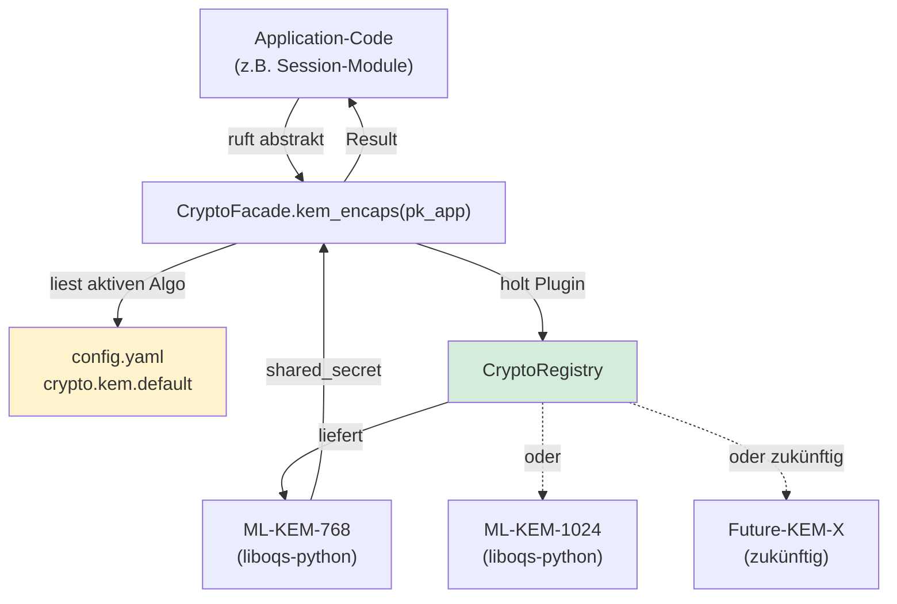

**Wichtigste Eigenschaft**: Application-Code referenziert keine konkreten Algorithmus-Namen (kein Import von `mlkem768`, kein String `"ML-KEM-768"` ausserhalb der Crypto-Layer). Das macht den Wechsel von ML-KEM-768 zu ML-KEM-1024 zu einer reinen Config-Änderung.

### 6.3 Algorithmus-Registry Setup (beim Service-Start)

```python
# auth_service/crypto/registry_init.py
from liboqs import KeyEncapsulation, Signature

def init_crypto_registry(registry: CryptoRegistry, config: CryptoConfig):
    # KEM-Algorithmen
    for alg_name in config.kem.supported:
        if alg_name == "ML-KEM-768":
            registry.register_kem("ML-KEM-768", LibOqsKem("ML-KEM-768"))
        elif alg_name == "ML-KEM-1024":
            registry.register_kem("ML-KEM-1024", LibOqsKem("ML-KEM-1024"))
        else:
            raise ConfigError(f"Unknown KEM algorithm: {alg_name}")

    # Signatur-Algorithmen analog
    for alg_name in config.signature.supported:
        if alg_name == "ML-DSA-65":
            registry.register_signature("ML-DSA-65", LibOqsSignature("ML-DSA-65"))
        else:
            raise ConfigError(f"Unknown signature algorithm: {alg_name}")
```

Beim Wechsel auf einen neuen NIST-Standard (z.B. zukünftige FIPS-Updates) ist nur dieser File anzupassen plus ein neuer Plugin-Adapter. Application-Code bleibt unverändert.

### 6.4 Mobile-Side Crypto-Abstraction (TypeScript)

Symmetrisch zur Server-Seite, ein eigenes Modul pro Verantwortlichkeit:

```typescript
// crypto/kem.ts
import { ml_kem768, ml_kem1024 } from '@noble/post-quantum/ml-kem';
import { cryptoConfig } from '../config';

export type KemAlgorithm = 'ML-KEM-768' | 'ML-KEM-1024';

const KEM_IMPLS: Record<KemAlgorithm, typeof ml_kem768> = {
  'ML-KEM-768': ml_kem768,
  'ML-KEM-1024': ml_kem1024,
};

export function keygen(alg: KemAlgorithm = cryptoConfig.defaultKem) {
  const impl = KEM_IMPLS[alg];
  return impl.keygen();
}

export function encaps(publicKey: Uint8Array, alg: KemAlgorithm) {
  return KEM_IMPLS[alg].encapsulate(publicKey);
}

export function decaps(ciphertext: Uint8Array, privateKey: Uint8Array, alg: KemAlgorithm) {
  return KEM_IMPLS[alg].decapsulate(ciphertext, privateKey);
}

export function supportedAlgorithms(): KemAlgorithm[] {
  return Object.keys(KEM_IMPLS) as KemAlgorithm[];
}
```

Die App nutzt diese Abstraction-Module statt direkter `@noble/*`-Imports. Der einzige Ort, der konkrete Algorithmus-Namen kennt, ist diese Datei.

---

## 7. Versionsverlauf

| Version | Datum | Änderung |
|---|---|---|
| 1.0 | 08.05.2026 | Initial-Version. System-Kontext, Komponenten-Architektur (Server und Mobile), Deployment-Architektur, 5 Sequenz-Diagramme (UC-1, UC-2, UC-4, UC-5, UC-7), Datenmodell (Broker-Token, Session-Record, User-Record, Config-Struktur), Crypto-Abstraction-Layer Design mit Schnittstellen-Beispielen für Server und Mobile. |
