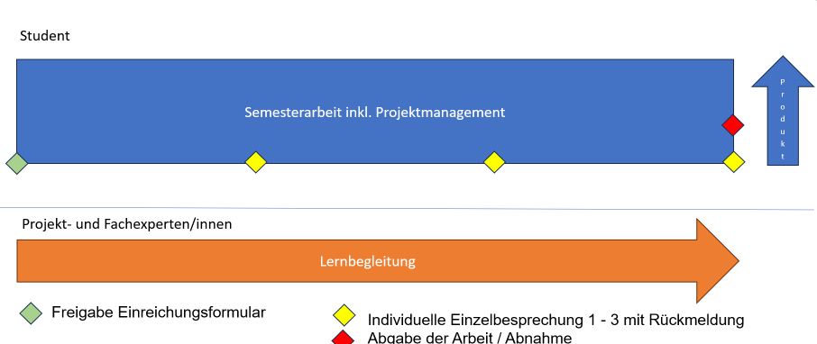
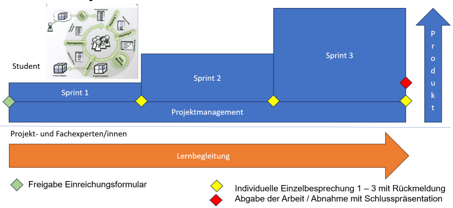

# Semesterarbeits-Merkblatt B

**Technische Berufsschule Zürich TBZ**

**Lehrgang dipl. Informatiker/in HF** (Stand: September 2024)

[[_TOC_]]

**Die Semesterarbeit ist gemäss Promotionsreglement vom 12.09.2024 Teil des Qualifikationsverfahrens.**

## Generischer Ablaufplan

| Datum       | Aktivität                                          | Wer           | Empfänger     |
|-------------|----------------------------------------------------|---------------|---------------|
| - ca. 18 Wochen | Informationsveranstaltung für Fachexperten     | Lehrgangsleitung | Fachexpert/innen  |
| - ca. 16 Wochen | Ablauf Semesterarbeiten und Liste mit Projektthemen/Fachexperten vorstellen | Lehrgangsleitung | Studierende   |
| - ca. 13 Wochen | Abgabe Einreichungsformular                    | Studierende   | Fach- und Projekt-Experte/innen  |
| Anwort innerhalb 5 - 7 Unterrichtstagen | Expert/innen           | Fach- und Projekt-Experte/innen 1 | Studierende |
| - ca. 12 Wochen | Beginn Umsetzung Semesterarbeit                | Studierende   | Fach- und Projekt-Experte/innen |
| - ca. 8 Wochen  | Individuelle Einzelbesprechung mit Rückmeldung 1  | Studierende| Fach- und Projekt-Experte/innen 1 |
| - ca. 4 Wochen  | Individuelle Einzelbesprechung mit Rückmeldung 2  | Studierende| Fach- und Projekt-Experte/innen 1 |
| - 1ne Woche     | Individuelle Einzelbesprechung mit Rückmeldung 3  | Studierende| Fach- und Projekt-Experte/innen 1|
| Abgabe          | Abgabe der Arbeit/Abnahme mit Schlusspräsentation (ab 2. Sem) | Studierende| Fach- und Projekt-Experte/innen 1 |
| + ca. 1ne Woche | Notenvorschlag / Notenkonferenz                | Projekt-Experte/in | Lehrgangsleitung |
| + ca. 2 Wochen  | Mitteilung der Noten mit individuellem Feedback zur Einsicht hochladen | Projekt-Experte/in | Studierende |
| + ca. 4 Wochen  | Mitteilung der Noten                           | Lehrgangsleitung/Sekretariat |Studierende |
| Beginn der Einsprachefrist | Studierender                         | Studierender         | Schulleitung  |
| + 30 Tage ab Mitteilung der Note | Ende der Einsprachefrist. Note ist definitiv | Lehrgangsleitung/Sekretariat | Studierender |

Anmerkung 1
* Rückmeldung von Fach- und Projekt-Experte/innen können Zeitversetzt erfolgen. 
* Vorzugsweise werden die Gespräche im Rahmen des Unterrichts durchgeführt. 
* Der Projekt-Experte/in schaltet eine Liste mit Terminslots auf.

**Bemerkungen zum Ablaufplan:**
- Die Experten müssen laufend auf den aktuellen Entwicklungsstand Zugriff haben.
- Die Studierenden sind für die Datenhaltung verantwortlich.

### 1. Semesterarbeit

- - -

In der 1. Semesterarbeit ist der Focus auf die Lernbegleitung.

### 2. - 5. Semesterarbeit

- - -

## Rollen

### Student (Durchführender der Semesterarbeit)

Rolle und Verantwortung:
* **Planung und Durchführung**: Der Student ist verantwortlich für die selbstständige Planung und Durchführung der Semesterarbeit. Dies umfasst das Erstellen eines Projektplans, das Definieren von Zielen und Meilensteinen (z.B. Sprint Abschlüsse) sowie die Umsetzung der Arbeitsschritte.
* **Dokumentation**: Der Student muss alle Arbeitsschritte, Ergebnisse und Erkenntnisse fortlaufend (z.B. mittels Git commits) und sorgfältig dokumentieren sowie in einem Abschlussbericht zusammenfassen.
* **Zeitmanagement**: Der Student ist dafür verantwortlich, die Arbeit im vorgegebenen Zeitrahmen abzuschliessen und die Ergebnisse termingerecht einzureichen.
* **Kommunikation**: Der Student hält regelmässigen Kontakt mit beiden Experten, um über den Fortschritt zu berichten, Fragen zu klären und Feedback einzuholen.
* **Eskalationen**: Eskalation zur HF-Lehrgangsleitung, z.B. bei grober Verletzung der Termine durch Experten.

Ab dem 2. Semester: **Präsentation**: Am Ende des Semesters präsentiert der Student seine Arbeit (Kolloquium) und das erstellte Produkt den beiden Experten.

### Experte Projektmanagement

Rolle und Verantwortung:
* **Beratung und Unterstützung**: Der Experte unterstützt den Studenten in allen Belangen des Projektmanagements, wie z.B. bei der Planung, der Zieldefinition und dem Risikomanagement.
* **Feedback*3: Der Experte bietet dem Studenten drei Einzelbesprechungen an, in denen er schriftliches Feedback (MS Teams) zum Projektfortschritt, insbesondere zur Effizienz und Effektivität des Managementprozesses, gibt. Diese Einzelbesprechungen sind nicht notenrelevant.
* **Bewertung**: Am Ende des Semesters (Abnahme) vergibt der Experte eine Note für die Projektmanagement-Komponente(n) der Arbeit. Die Note basiert auf dem Bewertungsraster laut Merkblätter Semesterarbeit.
* **Eskalationen**: Eskalation zur HF-Lehrgangsleitung, z.B. gegen Verstoss der Werte der TBZ.

### Experte Fachliches Modul

Rolle und Verantwortung:
* **Fachliche Unterstützung**: Der Experte steht dem Studenten in fachlichen Fragen zur Seite und unterstützt bei der Vertiefung der technischen Inhalte, die für die Semesterarbeit relevant sind.
* **Feedback**: Der Experte bietet dem Studenten drei Einzelbesprechungen mit schriftlichem Feedback zur fachlichen Entwicklung der Arbeit an und stellt sicher, dass diese den Standards der Höheren Fachschule entspricht. Die Einzelbesprechungen sind nicht notenrelevant.
* **Bewertung**: Am Ende des Semesters (Abnahme) vergibt der Experte eine Note für die fachliche Komponente(n) der Arbeit. Die Note basiert auf dem Bewertungsraster laut Merkblätter Semesterarbeit.
* **Eskalationen**: Eskalation zur HF-Lehrgangsleitung, z.B. gegen Verstoss der Werte der TBZ.

- - -

## Kommunikationsvorgaben

* Die Kommunikation findet via MS Teams Kanal statt.
* Die Termine laut Ablaufplan (z.B. Einzelbesprechungen) sind fix.
* Weitere Termine sind in gemeinsamer Absprache zu definieren

- - -

## Umschreibung der Semesterarbeit und Bewertung

**Ziel:** Die Semesterarbeit soll eine technische Arbeit aus einem der unterrichteten Module oder im Zusammenhang mit dem Labor der TBZ sein. Zusätzlich wird das Projektmanagement praktisch angewendet.

**Aufgabenstellung:** Grundsätzlich werden die Rahmenbedingungen von der TBZ vorgegeben. Die Studierenden definieren die Semesterarbeit gemäss dem Einreichungsformular. In begründeten Ausnahmefällen kann das Thema auch aus dem betrieblichen Umfeld gewählt werden. Die Studienleitung behält sich vor, Aufgabenstellungen anzupassen oder zurückzuweisen. Ein Thema, Modul darf nur einmal, im gleichen Kontext, für eine Semesterarbeit verwendet werden.

**Bewertung:** Die Bewertung erfolgt mittels untenstehender Kompetenzmatrix. Die Bewertung erfolgt aus Sicht des Kunden gemäss den nachfolgenden Gesichtspunkten:
- Hervorragende Arbeit: neue, kreative Lösungsansätze, produktiv einsetzbare Lösung.
- Gute Arbeit: Kunde zufrieden, Anforderungen weitgehend erfüllt, kleinere Anpassungen möglich.
- Genügende Arbeit: Prototyp erhalten, Version 2 würde Anforderungen erfüllen.
- Ungenügende Arbeit: Wichtige Anforderungen nicht erfüllt, nur Teile der Aufgabenstellung gelöst.
- Unbrauchbare Arbeit: Anforderungen in keiner Weise erfüllt.
- Abbruch der Arbeit oder illegaler Einsatz von Mitteln / Plagiat.

Die Note der Semesterarbeit soll auf eine Stelle nach dem Komma gerundet sein.

**Expert/innen:** Die Arbeiten sind einer Lehrperson der TBZ für die fachliche Begleitung sowie aus Sicht Projektmanagement begleitet.

**Dauer und Zeitaufwand:** Die Dauer sollte 12 Wochen nicht überschreiten. Als Zeitaufwand ist ca. 50 Stunden vorzusehen.

**Dokumentation:** Die Arbeit ist laufend zu dokumentieren. Die Experten sollen jederzeit den Stand der Arbeit überprüfen können. Die abzugebende Dokumentation (1 Exemplar) stellt das ganze Projekt in einem vernünftigen Umfang dar (inkl. geeigneten Datenträger mit allen relevanten Dateien). Nicht selbst verfasste Texte oder Programmteile sind deklariert und im Text mit einer exakten Quellenangabe gekennzeichnet.

**Arbeitsort:** Die Semesterarbeit kann in der Schule durchgeführt werden oder auch extern.

**Pflichten der Studierenden gegenüber den Expert/-innen:** Die Experten müssen jederzeit auf den aktuellen Zwischenstand der Semesterarbeit Zugriff haben. Falls im Verlaufe der Arbeit Projektänderungen nötig werden, muss die Zustimmung des Experten eingeholt werden. Zwischenstands-Besprechungen werden situativ mit den entsprechenden Dozenten vereinbart.

- - -

## Inhalt des Projektes

Jede Arbeit muss mindestens die nachfolgenden Punkte in einer geeigneten, dem Projekt entsprechenden Form enthalten (Relevant für die Bewertung der Kriterien 1-4):
- Projektablauf (gemäss Unterricht an der TBZ oder Standards der Firma)
- Evaluation von Lösungen
- Theoretische Lösungsansätze mit Begründung (System-Design)
- Dokumentation der Installation und Inbetriebnahme von Hard- und/oder Software (Beurteilung durch die Experten)
- Anpassung von Software oder Konfiguration von Geräten
- Projektdokumentation
- Projektabnahme/Übergabe/Schulung durch den Experten
- Beziehungen, Einflussgrössen und Schnittstellen
- Risikoanalyse und -management
- Falls erforderlich: Compliance und rechtliche Aspekte

**Optionale Elemente:**
- Performance-Analyse und Optimierungen
- Innovationsmanagement
- Nachhaltigkeitsaspekte
- Messbare Projektevaluation

- - -

## Kompetenzmatrix für Beurteilung der Semesterarbeit (für Dozent und Studierende)

* Notenschlüssel: Erreichte Punkte * 5 / max. Punkte + 1

### **1. Substanz, Aufbau des Inhalts** 

* 0 bis 5 Punkte
* Gewichtung: 1. - 3. Semester = 1, 4./5. Semester 0.2 

| **Kriterien**                                                                     | **RP**                  | **Novizenkompetenz**                                                                                                                                      | **Fortgeschrittene Kompetenz**                                                                                                                             | **Kompetenz professionellen Handelns**                                                                                                                     | **Kompetenzexpertise**                                                                                                                                     |
|-----------------------------------------------------------------------------------|-------------------------|----------------------------------------------------------------------------------------------------------------------------------------------------------|----------------------------------------------------------------------------------------------------------------------------------------------------------|------------------------------------------------------------------------------------------------------------------------------------------------------------|------------------------------------------------------------------------------------------------------------------------------------------------------------|
| **a) Verständliche Einführung ins Thema; nachvollziehbare Vorgehensweise**        | A2.1, A2.2              | Einführung ist teilweise unklar, Vorgehensweise nur rudimentär erkennbar                                                                                  | Einführung ist verständlich, Vorgehensweise erkennbar, aber nicht immer konsistent                                                                        | Einführung ist klar und gut strukturiert, Vorgehensweise nachvollziehbar und schlüssig                                                                      | Einführung ist prägnant, Vorgehensweise methodisch fundiert und vollständig nachvollziehbar                                                                  |
| **b) Inhalte entsprechen dem Thema bzw. der Aufgabenstellung**                    | A1.1, B7.2              | Themenbezug teilweise ungenau, Inhalte nicht immer passend                                                                                                | Themenbezug ist grundsätzlich gegeben, kleinere Abweichungen in den Inhalten                                                                               | Inhalte entsprechen dem Thema, Aufgabenstellung wird vollständig erfasst                                                                                    | Inhalte sind präzise auf die Aufgabenstellung abgestimmt und decken alle relevanten Aspekte umfassend ab                                                     |
| **c) Text ist prägnant und enthält keine Redundanzen oder unnötigen Inhalte**     | A2.3                    | Text enthält überflüssige Informationen oder Redundanzen                                                                                                  | Text ist größtenteils prägnant, enthält jedoch kleinere Redundanzen                                                                                        | Text ist prägnant und auf den Punkt, ohne unnötige Redundanzen                                                                                              | Text ist präzise, vollständig und vollkommen frei von unnötigen Inhalten                                                                                     |
| **d) Aussagen sind klar und eindeutig, notwendige Vertiefungen vorhanden**        | A1.3, A3.1, A2.4        | Aussagen sind teilweise unklar oder vage, Vertiefungen fehlen oder sind unzureichend                                                                       | Aussagen sind meist klar, Vertiefungen sind erkennbar, aber nicht vollständig                                                                              | Aussagen sind klar und eindeutig, notwendige Vertiefungen sind angemessen vorhanden                                                                          | Aussagen sind prägnant, fundiert und tiefgehend, Vertiefungen sind fachlich durchdacht und umfassend                                                         |
| **e) Dokumentation ist fehlerfrei und sauber formatiert**                         | B5.9, B8.1              | Dokumentation enthält häufige Fehler und Formatierungen sind uneinheitlich                                                                                 | Dokumentation ist größtenteils fehlerfrei, kleinere Formatierungsfehler vorhanden                                                                          | Dokumentation ist fehlerfrei und professionell formatiert                                                                                                   | Dokumentation ist makellos, professionell und entspricht höchsten Qualitätsstandards                                                                         |
| **f) Verzeichnisse und Zusammenfassungen sind vorhanden**                        | B5.9, A1.1              | Verzeichnisse oder Zusammenfassungen fehlen oder sind unvollständig                                                                                        | Verzeichnisse und Zusammenfassungen sind vorhanden, aber lückenhaft                                                                                        | Verzeichnisse und Zusammenfassungen sind vollständig und korrekt                                                                                            | Verzeichnisse und Zusammenfassungen sind umfassend, strukturiert und bieten einen vollständigen Überblick über die Inhalte                                     |

* Spalte **RP** = [Rahmenlehrplan](https://gitlab.com/ch-tbz-wb/general/hf-moduls/-/blob/master/rahmenlehrplan.md)

- - -

### **2. Darstellung der Theorie**

* 0 bis 5 Punkte
* Gewichtung: 1. - 3. Semester = 1, 4./5. Semester 0.2 

| **Kriterium**                                                                                          | **RP** | **Novizenkompetenz**                                                                                                       | **fortgeschrittene Kompetenz**                                                                                           | **Kompetenz professionellen Handelns**                                                                                   | **Kompetenzexpertise**                                                                                                     |
|--------------------------------------------------------------------------------------------------------|--------|----------------------------------------------------------------------------------------------------------------------------|--------------------------------------------------------------------------------------------------------------------------|--------------------------------------------------------------------------------------------------------------------------|----------------------------------------------------------------------------------------------------------------------------|
| **a) Erlernte Theorien (Methoden, Techniken) werden korrekt dargestellt**                               | A1.3   | Die Theorie wird benannt, aber ungenau oder lückenhaft wiedergegeben.                                                      | Die Theorie wird korrekt beschrieben, aber nicht vollständig angewendet.                                                 | Die Theorie wird korrekt beschrieben und weitgehend korrekt angewendet.                                                   | Die Theorie wird vollständig korrekt beschrieben und souverän auf verschiedene Kontexte angewendet.                       |
| **b) Sinnvolle Beispiele werden aufgezeigt**                                                            | A2.3   | Es werden einfache Beispiele genannt, die teilweise unpassend oder allgemein sind.                                          | Beispiele werden genannt, die den theoretischen Inhalt verdeutlichen, aber nicht immer perfekt passen.                    | Beispiele sind präzise und unterstützen das Verständnis der Theorie im relevanten Kontext.                                | Beispiele sind kreativ, spezifisch und klar in den Kontext eingebunden, um komplexe Sachverhalte darzustellen.             |
| **c) Verwendete Methoden sind benannt und erkennbar**                                                   | B4.4   | Methoden werden nur teilweise benannt und sind nur in Ansätzen erkennbar.                                                   | Die benannten Methoden sind erkennbar und werden weitgehend korrekt verwendet.                                            | Methoden werden präzise benannt und zielführend angewendet.                                                               | Methoden werden problemlos identifiziert und flexibel an verschiedene Situationen angepasst.                              |
| **d) Gefühlspunkte: «Ich glaube, die/der hat verstanden, was er schreibt.»**                            | A3.3   | Es bestehen Zweifel am vollständigen Verständnis der Materie.                                                              | Ein grundsätzliches Verständnis der Materie ist vorhanden, aber es gibt noch Unklarheiten.                                | Das Verständnis der Materie ist deutlich erkennbar, mit klaren und schlüssigen Aussagen.                                   | Tiefergehendes Verständnis ist offensichtlich, mit klaren, durchdachten und fundierten Aussagen, die tiefe Expertise zeigen.| 

* Spalte **RP** = [Rahmenlehrplan](https://gitlab.com/ch-tbz-wb/general/hf-moduls/-/blob/master/rahmenlehrplan.md)

- - -

### **3. Verknüpfung von Theorie und Praxis**

* 0 bis 5 Punkte
* Gewichtung: 1. - 3. Semester = 1, 4./5. Semester 0.2 

| **Kriterium**                                                                                          | **RP** | **Novizenkompetenz**                                                                                                       | **fortgeschrittene Kompetenz**                                                                                           | **Kompetenz professionellen Handelns**                                                                                   | **Kompetenzexpertise**                                                                                                     |
|--------------------------------------------------------------------------------------------------------|--------|----------------------------------------------------------------------------------------------------------------------------|--------------------------------------------------------------------------------------------------------------------------|--------------------------------------------------------------------------------------------------------------------------|----------------------------------------------------------------------------------------------------------------------------|
| **a) Theorien aus den Modulen werden korrekt dargestellt**                                              | A1.2   | Theorien werden teilweise unvollständig oder ungenau wiedergegeben.                                                        | Theorien werden korrekt, aber nicht immer tiefgehend dargestellt.                                                        | Theorien werden korrekt und detailliert dargestellt, weitgehend korrekt angewendet.                                        | Theorien werden vollständig, korrekt und flexibel in unterschiedlichen Kontexten souverän angewendet.                      |
| **b) Beispiele werden sinnvoll aufgezeigt**                                                             | A1.3   | Beispiele sind allgemein, wenig passend oder teilweise ungenau.                                                            | Beispiele sind sinnvoll, verdeutlichen die Theorie, sind aber nicht immer passend.                                        | Beispiele sind präzise, passend und veranschaulichen die Theorie im jeweiligen Kontext.                                    | Beispiele sind kreativ, spezifisch und hervorragend in den Kontext eingebunden, um komplexe Sachverhalte zu verdeutlichen.  |
| **c) Verwendete Methoden sind benannt und erkennbar**                                                   | B4.4   | Methoden werden ungenau benannt und sind schwer erkennbar.                                                                 | Methoden sind benannt und weitgehend erkennbar, jedoch nicht immer korrekt angewendet.                                    | Methoden sind präzise benannt und zielführend angewendet.                                                                 | Methoden sind flexibel, korrekt und in verschiedenen Situationen angepasst und durchdacht eingesetzt.                      |
| **d) Praxisbeispiele sind den Modulinhalten zuordenbar**                                                | A1.3   | Praxisbeispiele passen teilweise zu den Modulinhalten, sind aber ungenau oder nicht gut erkennbar.                         | Praxisbeispiele sind weitgehend passend und verdeutlichen die Modulinhalte, jedoch mit kleineren Unklarheiten.            | Praxisbeispiele passen gut zu den Modulinhalten und sind klar zuordenbar.                                                  | Praxisbeispiele sind hervorragend zugeordnet und verdeutlichen die Modulinhalte auf tiefgehende Weise.                     |
| **e) Verknüpfung von Theorie und Praxis ist sinnvoll und nachvollziehbar**                              | A2.3   | Verknüpfung ist unklar oder unsystematisch.                                                                                | Verknüpfung ist nachvollziehbar, aber nicht immer stimmig oder vollständig.                                               | Verknüpfung von Theorie und Praxis ist schlüssig und verständlich dargestellt.                                              | Verknüpfung ist tiefgehend, flexibel und zeigt ein hohes Maß an Verständnis für beide Bereiche.                            |
| **f) Praktische Ausgangslage ist verständlich beschrieben**                                             | A2.3   | Ausgangslage wird ungenau oder lückenhaft beschrieben.                                                                     | Ausgangslage ist verständlich beschrieben, aber mit kleineren Lücken oder Unklarheiten.                                   | Ausgangslage ist klar und präzise beschrieben, unterstützt durch relevante Details.                                         | Ausgangslage ist umfassend beschrieben, mit tiefem Verständnis der relevanten Details und Auswirkungen.                    |
| **g) Handlungsempfehlungen für das weitere Vorgehen machen Sinn**                                       | A2.3   | Handlungsempfehlungen sind allgemein oder ungenau formuliert und nicht immer zielführend.                                   | Handlungsempfehlungen sind sinnvoll, jedoch mit kleinen Unklarheiten oder fehlender Tiefe.                                | Handlungsempfehlungen sind klar, sinnvoll und zielführend formuliert.                                                      | Handlungsempfehlungen sind fundiert, durchdacht und auf ein tiefes Verständnis der Sachlage abgestimmt.                   |
| **h) Gefühlspunkte: «Ich glaube, die/der hat verstanden, was er schreibt.»**                            | A3.2   | Es besteht Unsicherheit über das volle Verständnis des Themas.                                                             | Ein grundsätzliches Verständnis ist erkennbar, aber es bleiben Unklarheiten.                                              | Verständnis ist klar erkennbar, mit schlüssigen Aussagen und sicherer Darstellung.                                         | Tiefergehendes Verständnis ist offensichtlich, mit fundierten und durchdachten Aussagen, die umfassende Expertise zeigen.   |

* Spalte **RP** = [Rahmenlehrplan](https://gitlab.com/ch-tbz-wb/general/hf-moduls/-/blob/master/rahmenlehrplan.md)

- - -

### **4. Verknüpfung von Theorie und Praxis (fachlich)**

* 0 bis 5 Punkte
* Gewichtung: 1. - 3. Semester = 1, 4./5. Semester 2.0

| **Kriterium**                                                                                          | **RP** | **Novizenkompetenz**                                                                                                       | **fortgeschrittene Kompetenz**                                                                                           | **Kompetenz professionellen Handelns**                                                                                   | **Kompetenzexpertise**                                                                                                     |
|--------------------------------------------------------------------------------------------------------|--------|----------------------------------------------------------------------------------------------------------------------------|--------------------------------------------------------------------------------------------------------------------------|--------------------------------------------------------------------------------------------------------------------------|----------------------------------------------------------------------------------------------------------------------------|
| **a) Theorien aus den Modulen werden korrekt dargestellt**                                              | A1.2   | Theorien werden teilweise unvollständig oder ungenau wiedergegeben.                                                        | Theorien werden korrekt, aber nicht immer tiefgehend dargestellt.                                                        | Theorien werden korrekt und detailliert dargestellt, weitgehend korrekt angewendet.                                        | Theorien werden vollständig, korrekt und flexibel in unterschiedlichen Kontexten souverän angewendet.                      |
| **b) Beispiele werden sinnvoll aufgezeigt**                                                             | A1.3   | Beispiele sind allgemein, wenig passend oder teilweise ungenau.                                                            | Beispiele sind sinnvoll, verdeutlichen die Theorie, sind aber nicht immer passend.                                        | Beispiele sind präzise, passend und veranschaulichen die Theorie im jeweiligen Kontext.                                    | Beispiele sind kreativ, spezifisch und hervorragend in den Kontext eingebunden, um komplexe Sachverhalte zu verdeutlichen.  |
| **c) Verwendete Methoden sind benannt und erkennbar**                                                   | B4.4   | Methoden werden ungenau benannt und sind schwer erkennbar.                                                                 | Methoden sind benannt und weitgehend erkennbar, jedoch nicht immer korrekt angewendet.                                    | Methoden sind präzise benannt und zielführend angewendet.                                                                 | Methoden sind flexibel, korrekt und in verschiedenen Situationen angepasst und durchdacht eingesetzt.                      |
| **d) Praxisbeispiele sind den Modulinhalten zuordenbar**                                                | A1.3   | Praxisbeispiele passen teilweise zu den Modulinhalten, sind aber ungenau oder nicht gut erkennbar.                         | Praxisbeispiele sind weitgehend passend und verdeutlichen die Modulinhalte, jedoch mit kleineren Unklarheiten.            | Praxisbeispiele passen gut zu den Modulinhalten und sind klar zuordenbar.                                                  | Praxisbeispiele sind hervorragend zugeordnet und verdeutlichen die Modulinhalte auf tiefgehende Weise.                     |
| **e) Verknüpfung von Theorie und Praxis ist sinnvoll und nachvollziehbar**                              | A2.3   | Verknüpfung ist unklar oder unsystematisch.                                                                                | Verknüpfung ist nachvollziehbar, aber nicht immer stimmig oder vollständig.                                               | Verknüpfung von Theorie und Praxis ist schlüssig und verständlich dargestellt.                                              | Verknüpfung ist tiefgehend, flexibel und zeigt ein hohes Maß an Verständnis für beide Bereiche.                            |
| **f) Praktische Ausgangslage ist verständlich beschrieben**                                             | A2.3   | Ausgangslage wird ungenau oder lückenhaft beschrieben.                                                                     | Ausgangslage ist verständlich beschrieben, aber mit kleineren Lücken oder Unklarheiten.                                   | Ausgangslage ist klar und präzise beschrieben, unterstützt durch relevante Details.                                         | Ausgangslage ist umfassend beschrieben, mit tiefem Verständnis der relevanten Details und Auswirkungen.                    |
| **g) Handlungsempfehlungen für das weitere Vorgehen machen Sinn**                                       | A2.3   | Handlungsempfehlungen sind allgemein oder ungenau formuliert und nicht immer zielführend.                                   | Handlungsempfehlungen sind sinnvoll, jedoch mit kleinen Unklarheiten oder fehlender Tiefe.                                | Handlungsempfehlungen sind klar, sinnvoll und zielführend formuliert.                                                      | Handlungsempfehlungen sind fundiert, durchdacht und auf ein tiefes Verständnis der Sachlage abgestimmt.                   |
| **h) Gefühlspunkte: «Ich glaube, die/der hat verstanden, was er schreibt.»**                            | A3.2   | Es besteht Unsicherheit über das volle Verständnis des Themas.                                                             | Ein grundsätzliches Verständnis ist erkennbar, aber es bleiben Unklarheiten.                                              | Verständnis ist klar erkennbar, mit schlüssigen Aussagen und sicherer Darstellung.                                         | Tiefergehendes Verständnis ist offensichtlich, mit fundierten und durchdachten Aussagen, die umfassende Expertise zeigen.   |

* Spalte **RP** = [Rahmenlehrplan](https://gitlab.com/ch-tbz-wb/general/hf-moduls/-/blob/master/rahmenlehrplan.md)

### **5. Reflexionstiefe**

* 0 bis 5 Punkte
* Gewichtung: 1.0

| **Kriterium**                                                                                          | **RP** | **Novizenkompetenz**                                                                                                       | **fortgeschrittene Kompetenz**                                                                                           | **Kompetenz professionellen Handelns**                                                                                   | **Kompetenzexpertise**                                                                                                     |
|--------------------------------------------------------------------------------------------------------|--------|----------------------------------------------------------------------------------------------------------------------------|--------------------------------------------------------------------------------------------------------------------------|--------------------------------------------------------------------------------------------------------------------------|----------------------------------------------------------------------------------------------------------------------------|
| **a) Gemachte Aussagen werden hinterfragt**                                                             | A3.1   | Aussagen werden unkritisch übernommen, Hinterfragen ist kaum vorhanden.                                                    | Aussagen werden teilweise hinterfragt, jedoch nicht immer systematisch.                                                   | Aussagen werden gezielt hinterfragt und auf Plausibilität geprüft.                                                         | Aussagen werden umfassend hinterfragt, kritische Reflexion ist erkennbar und tiefgehend.                                    |
| **b) Lösungen werden abgewogen, verschiedene Varianten einander gegenübergestellt**                     | B1.2   | Lösungsvarianten werden kaum verglichen, die Bewertung ist oberflächlich.                                                  | Verschiedene Lösungsansätze werden abgewogen, aber nicht immer fundiert verglichen.                                       | Varianten werden fundiert gegeneinander abgewogen und Vor- und Nachteile aufgezeigt.                                       | Varianten werden umfassend analysiert und gegeneinander abgewogen, mit klaren Empfehlungen basierend auf fundierten Kriterien. |
| **c) Eigene Erfahrungen werden eingebracht**                                                            | B2.1   | Eigene Erfahrungen werden kaum oder nur oberflächlich eingebracht.                                                         | Eigene Erfahrungen werden eingebracht, jedoch ohne tiefere Reflexion.                                                     | Eigene Erfahrungen werden sinnvoll eingebracht und mit der Theorie verknüpft.                                              | Eigene Erfahrungen werden gezielt eingebracht, reflektiert und bieten wertvolle Erkenntnisse für die Problemstellung.       |
| **d) Vorbehalte der eigenen Lösung werden aufgezeigt oder entkräftet**                                  | B2.2   | Vorbehalte werden kaum angesprochen oder unzureichend behandelt.                                                           | Vorbehalte werden angesprochen, aber nicht vollständig entkräftet oder reflektiert.                                        | Vorbehalte werden klar formuliert und teilweise entkräftet oder schlüssig begründet.                                       | Vorbehalte werden umfassend reflektiert und gezielt entkräftet, mit tiefergehender Analyse möglicher Schwächen.             |
| **e) Erkenntnisse aus der Bearbeitung des Auftrags werden aufgezeigt oder sind spürbar**                | A3.2   | Erkenntnisse werden kaum formuliert oder sind nur implizit erkennbar.                                                      | Erkenntnisse werden aufgezeigt, aber sind teilweise oberflächlich oder unsystematisch.                                    | Erkenntnisse werden klar formuliert und mit der Auftragsbearbeitung verknüpft.                                              | Erkenntnisse werden tiefgehend reflektiert und bieten einen klaren Mehrwert durch die Analyse des gesamten Bearbeitungsprozesses. |

* Spalte **RP** = [Rahmenlehrplan](https://gitlab.com/ch-tbz-wb/general/hf-moduls/-/blob/master/rahmenlehrplan.md)

- - - 

### **6. Kolloquium (Produkte Vorführung)**

* 0 bis 5 Punkte
* Gewichtung: 1. Semester 0.0, ab 2. Semester 1.0

| **Kriterium**                                                                                          | **RP**  | **Novizenkompetenz**                                                                                                       | **Fortgeschrittene Kompetenz**                                                                                           | **Kompetenz professionellen Handelns**                                                                                   | **Kompetenzexpertise**                                                                                                     |
|--------------------------------------------------------------------------------------------------------|---------|----------------------------------------------------------------------------------------------------------------------------|--------------------------------------------------------------------------------------------------------------------------|--------------------------------------------------------------------------------------------------------------------------|----------------------------------------------------------------------------------------------------------------------------|
| **a) Fachliche und verständliche Einführung ins Thema**                                                 | A1.1    | Die Einführung ist ungenau, unvollständig oder schwer verständlich.                                                        | Die Einführung ist verständlich, aber es fehlen noch wichtige Aspekte.                                                    | Die Einführung ist klar, fachlich korrekt und deckt alle wesentlichen Punkte ab.                                           | Die Einführung ist fachlich tiefgehend, sehr verständlich und führt umfassend ins Thema ein.                                |
| **b) Die Präsentation ist von Anfang bis Schluss gut organisiert**                                      | A2.1    | Die Organisation der Präsentation ist unklar oder lückenhaft.                                                             | Die Präsentation ist weitgehend organisiert, aber es gibt noch Unstimmigkeiten im Ablauf.                                 | Die Präsentation ist klar strukturiert und gut organisiert, der Ablauf ist stimmig.                                        | Die Präsentation ist exzellent organisiert, der Ablauf ist durchdacht und kohärent von Anfang bis Ende.                    |
| **c) Alles wurde gut veranschaulicht – es wurden unterschiedliche Medien eingesetzt**                   | A3.1    | Veranschaulichungen sind teilweise unklar, und es werden kaum verschiedene Medien eingesetzt.                               | Verschiedene Medien werden eingesetzt, jedoch nicht immer passend oder effektiv.                                           | Die Präsentation nutzt verschiedene Medien sinnvoll zur Veranschaulichung der Inhalte.                                      | Die Veranschaulichung ist hervorragend, Medien werden kreativ und effektiv zur Unterstützung der Inhalte eingesetzt.        |
| **d) Form und Darstellung – alles ist gut lesbar und übersichtlich**                                    | B1.1    | Darstellung ist unübersichtlich oder schwer lesbar, mit Mängeln in der Gestaltung.                                          | Darstellung ist überwiegend lesbar, jedoch gibt es kleinere Unstimmigkeiten in der Übersichtlichkeit.                      | Die Darstellung ist gut lesbar und übersichtlich, die Gestaltung unterstützt das Verständnis.                              | Die Darstellung ist hervorragend lesbar, sehr übersichtlich und optimal gestaltet, um das Verständnis zu fördern.           |
| **e) Ablaufgestaltung – Einstieg, Hauptteil, Abschluss**                                                | B2.2    | Der Ablauf ist unstrukturiert, mit schwachem Einstieg, unklarem Hauptteil oder Abschluss.                                   | Der Ablauf ist klar erkennbar, jedoch gibt es Schwächen in einem der Teile (Einstieg, Hauptteil, Abschluss).               | Der Ablauf ist gut strukturiert und ausgeglichen, alle Teile sind klar erkennbar und sinnvoll aufeinander aufgebaut.        | Der Ablauf ist exzellent gestaltet, mit einem starken Einstieg, einem prägnanten Hauptteil und einem überzeugenden Abschluss. |
| **f) Zeitmanagement (Präsentation, Fragen) – wurde eingehalten**                                        | B3.1    | Zeitmanagement ist ungenau, es kommt zu erheblichen Abweichungen im geplanten Ablauf.                                       | Zeitmanagement ist größtenteils eingehalten, es gibt jedoch kleinere Überschreitungen oder Kürzungen.                     | Zeitmanagement ist gut, der Ablauf entspricht weitgehend der geplanten Zeitvorgabe, inklusive Fragen.                       | Zeitmanagement ist optimal, die Präsentation verläuft exakt nach Plan, und Fragen werden umfassend und innerhalb der Zeit behandelt. |

* Spalte **RP** = [Rahmenlehrplan](https://gitlab.com/ch-tbz-wb/general/hf-moduls/-/blob/master/rahmenlehrplan.md)

- - -

## Rechtsmittelbelehrung der Semesterarbeiten

Gegen die Noten/Beurteilungen der Semesterarbeit kann innert 30 Tagen, vom Empfang angerechnet, bei der Schulleitung schriftlich Einsprache erhoben werden. Die Einsprache muss einen Antrag und dessen Begründung enthalten. Die Beweismittel sind genau zu bezeichnen und soweit möglich beizulegen. 

## Rechtsmittelbelehrung des Einsprache Entscheids 

Gegen diesen Entscheid kann innert 30 Tagen, vom Empfang angerechnet, bei der Bildungsdirektion, General-sekretariat /Rekurs Abteilung, 8090 Zürich, schriftlich Rekurs (im Doppel) eingereicht werden. Der Rekurs muss einen Antrag und dessen Begründung enthalten. Der angefochtene Entscheid ist beizulegen oder genau zu be-zeichnen. Die angerufenen Beweismittel sind genau zu bezeichnen und soweit möglich beizulegen. Mit dem Rekurs können alle Mängel des Verfahrens und des angefochtenen Entscheids geltend gemacht werden. 

- - - 

 Dieses Werk ist lizenziert unter einer <a rel="license" href="http://creativecommons.org/licenses/by-nc-sa/3.0/ch/">Creative Commons Namensnennung - Nicht-kommerziell - Weitergabe unter gleichen Bedingungen 3.0 Schweiz Lizenz</a>.

- - - 